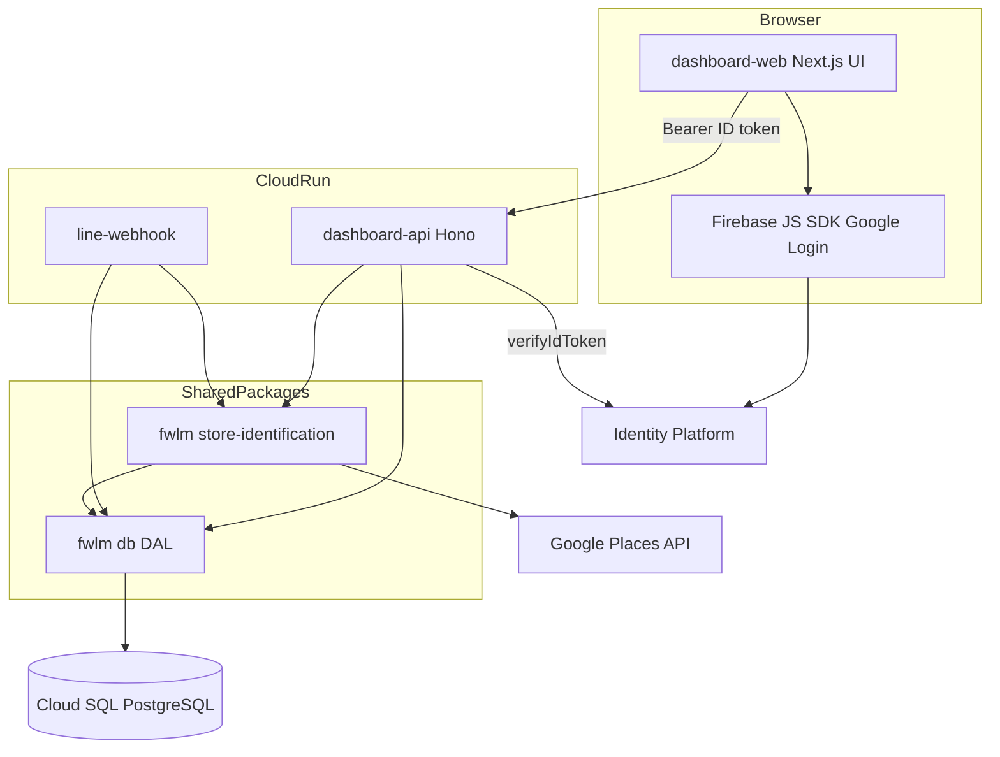
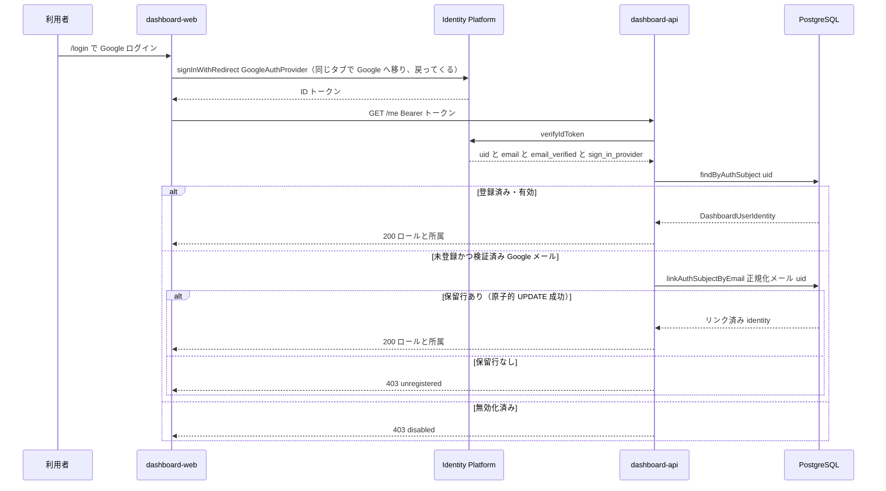
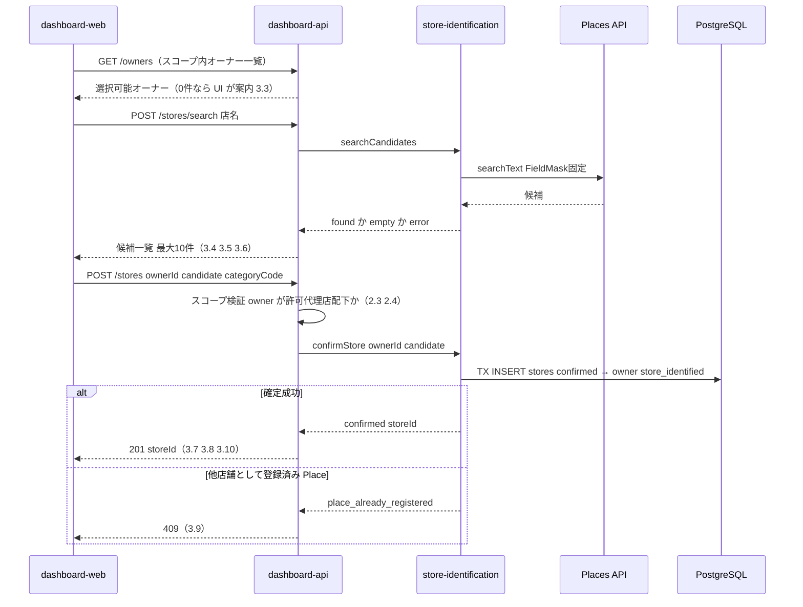

# Technical Design: agency-dashboard

## Overview

**Purpose**: 本機能は、運営と代理店に対し、Google ログインと RBAC で保護された Web ダッシュボードを提供する。代理店は担当オーナーの店舗特定（店名検索 → Place 確定）を代行し、担当店舗の状態（店舗特定・競合設定）を一覧確認し、招待コードを自力で発行できる。運営は全店舗の俯瞰と、代理店・ダッシュボード利用者の管理を行える。

**Users**: 代理店ロールの利用者は店舗登録・一覧・招待コード管理に利用する。運営ロールの利用者は全店舗の俯瞰と代理店・利用者アカウントの管理に利用する。

**Impact**: 既存の `dashboard-api`（現状 `/health` と QR 発行のみ）を業務 API へ拡張し、新規 Next.js アプリ `dashboard-web` を追加する。`dashboard_users` テーブルに列追加（migration 0005）を行い、line-webhook 内の店舗特定ロジックを共有パッケージへ移設する。

### Goals

- 運営・代理店が Google ログインのみでダッシュボードを利用できる（パスワード自前管理なし）
- RBAC（運営=全店、代理店=担当店のみ）をサーバー側で構造的に強制する
- 店舗特定の代行フローを LINE オンボーディングと単一実装で共有する
- 招待コード・代理店・利用者の管理を手作業のデータ投入なしに完結させる

### Non-Goals

- 店ごとの詳細分析画面・売上レポート（第2フェーズ）
- 競合店舗の選定・編集（日次バッチの責務。本ダッシュボードは表示のみ）
- オーナーの LINE 側オンボーディングフローの変更（`line-onboarding` の所有）
- Google OAuth 連携・機能2（第2フェーズ）
- オーナー未登録のままの店舗先行登録

## Boundary Commitments

### This Spec Owns

- `ts/apps/dashboard-web`（新規 Next.js アプリ）の全体
- `ts/apps/dashboard-api` の業務エンドポイント群と認証拡張（初回ログイン時リンク・無効化判定・CORS）
- `ts/packages/store-identification`（新規共有パッケージ）の創設と、line-webhook の import 差し替え
- `@fwlm/db` への追加アクセサ（店舗一覧・オーナー一覧・代理店・利用者・招待コード・カテゴリ）
- migration `0005_agency_dashboard.sql`（`dashboard_users` への列追加）と関連ドキュメント（ERD・write-boundary）・DB テスト
- migration `0017_owner_invite_code.sql`（`owners.invite_code_id` の追加・Requirement 8・Issue #486）と、それを書く・読むための契約変更（`@fwlm/db` の `createOwner` / `findActiveInviteCode` / `listOwnersByAgency`（`owner-line-unlink` 4.4 で `listOwners` へ置き換え）、line-webhook の `createOwner` 呼び出し 1 箇所への id の受け渡し）
- 代理店詳細画面（`/admin/agencies/[agencyId]`・Requirement 9・Issue #486）と、そのために共用部品（`OwnerRosterTable`・`TopNav`・状態の表示語）へ足す変更
- 一覧の名前から詳細への遷移、店舗の詳細（`/stores/[storeId]`）・オーナーの詳細（`/owners/[ownerId]`）、1 件を返す GET /stores/:id・GET /owners/:id と、そのために共用部品（`StoreQrPanel`・`OwnerRosterTable`・停止と連携解除の操作部品）へ足す変更（Requirement 10・11・Issue #526）
- 自サービスの CI/デプロイ配線（`push-images.sh`・`deploy.yml`・`infra/envs/prod/main.tf` への dashboard-web / dashboard-api エントリ追加）

### Out of Boundary

- 招待コードの検証・消費（オーナー紐付け）: `line-onboarding` の所有。本 spec は発行・無効化・表示のみ。ただし Requirement 8 の記録は登録の時点でしか取れないため、会話フロー（段階・案内文・ロック・トランザクション境界）は変えずに、既存の `createOwner` 呼び出しへ検証済みのコードの id を渡す変更だけを本 spec が行う
- 競合の自動選定・日次指標取得: `competitive-daily-summary`（Go バッチ）の所有。本 spec は `competitors` を read するのみ（書込禁止）
- Identity Platform 基盤（`infra/modules/auth`）と Cloud Run モジュール自体の変更: `gcp-infra-foundation` の所有。本 spec は `envs/prod` のサービスエントリ追加のみ
- 客向け機能（survey-web / store-detail）・LINE Webhook の会話フロー
- 初代運営ユーザーの投入（鶏卵問題）: seed/手動 SQL の運用手順であり、アプリ機能として持たない

### Allowed Dependencies

- `@fwlm/db`（DAL・型）、`@fwlm/store-identification`（本 spec で新設）
- firebase-admin（トークン検証）、firebase JS SDK（dashboard-web のログインのみ）
- Google Places API (New) searchText — `PlacesSearchAdapter` 経由のみ（直接呼び出し禁止・FieldMask 変更禁止）
- Go 所有テーブル（`competitors`）への **read のみ**
- 依存方向: `dashboard-web → dashboard-api → @fwlm/store-identification / @fwlm/db → PostgreSQL`。逆方向・スキップ（dashboard-web から DB 直結）は違反

### Revalidation Triggers

- `dashboard_users` のスキーマ・認証解決契約（`findByAuthSubject`）の変更 → dashboard-api / 将来の利用者管理系すべて
- `@fwlm/store-identification` の契約（`SearchOutcome` / `ConfirmOutcome`）変更 → line-webhook の再検証必須
- `agency_invite_codes` の有効判定（`disabled_at`）の意味変更 → `line-onboarding` の再検証必須
- dashboard-api のエラー封筒（`{error:{code,message}}`）変更 → dashboard-web・QR 利用箇所
- `owners` を作る経路の追加、または `createOwner` / `findActiveInviteCode` の契約変更 → `line-onboarding` の再検証必須（新しい経路が `invite_code_id` を書かないと、導入後の登録なのに「記録なし」になる・8.1）
- `agency_invite_codes` の物理削除の導入 → Requirement 8.3 の再検証必須（記録が参照するコードは `ON DELETE RESTRICT` で消せない）
- `OwnerRosterTable` の列・引数の変更 → 店舗登録（3.12）と代理店詳細（9.2）の両方の再検証必須（同じ部品を 2 面が使う）
- GET /owners・GET /stores・GET /invite-codes が、存在しない代理店の指定に空配列以外（404 など）を返すようにする変更 → 代理店詳細の存在判定（9.6）の再検証
- `listStoresWithStatus` の列・判定の変更 → GET /stores/:id とオーナーの詳細の店舗の表（11.1・11.7）の再検証（同じ列の定義を共有する）
- `StoreSuspensionControl`・`OwnerLineUnlinkControl`・`StoreQrPanel` の条件・引数の変更 → 一覧と詳細の両方の再検証必須（同じ部品を 2 面が使う・11.2・11.5・11.8）
- GET /stores/:id・GET /owners/:id が担当外と不存在を区別する応答（403 と 404 など）を返すようにする変更 → 11.9 に反する。応答は 404 の 1 通りに保つ

## Architecture

### Existing Architecture Analysis

- dashboard-api は「`createApp(deps)` ファクトリ＋依存注入・ハンドラは純関数・`app.request` でテスト」の型が確立済み。本設計はこの型を全エンドポイントに踏襲する。
- 認証は `authenticate(deps, authorization)` の3値結果（`unauthenticated`/`unregistered`/`authenticated`）。本設計はここに `disabled` 判定と初回ログイン時リンクを追加拡張する。
- 書き込み境界: 本 spec が書く `stores`/`owners`/`agencies`/`dashboard_users`/`agency_invite_codes` は全て TS リアルタイム応答層所有で整合。`competitors` は read のみ。
- Next.js アプリは `output:'standalone'`・4ステージ Dockerfile（context=`ts/`）・`NEXT_PUBLIC_*` build-arg 規律。dashboard-web もこれに従う（src レイアウトは survey-web 型の `src/app`）。

### Architecture Pattern & Boundary Map



**Architecture Integration**:

- Selected pattern: gap 分析 Option C（UI とビジネス API の分離・API 集約）。認証・RBAC・QR と業務 API を dashboard-api に単一集約し、二重化を排除する。
- Domain boundaries: dashboard-web は「表示とログイン」のみ。認可判定・データ変更は全て dashboard-api（サーバー側）。UI の出し分けは利便性であり防御ではない（2.3）。
- Existing patterns preserved: `createApp(deps)` DI、`jsonError` 封筒、`*.db.test.ts`、`ConnectablePool` TX、FieldMask Pro SKU 固定。
- New components rationale: `@fwlm/store-identification` は LINE とダッシュボードの2消費者が確定したため昇格（複製による SKU 規律の二重管理を排除）。
- Steering compliance: 書込境界（TS 層のみ書込）・4階層モデル・共有定数の単一情報源（categories は DAL 経由）・`NEXT_PUBLIC_*` build-arg 規律。

### Technology Stack

| Layer | Choice / Version | Role in Feature | Notes |
|-------|------------------|-----------------|-------|
| Frontend | Next.js ^16 / React ^19（`ts/apps/dashboard-web`・新規） | 運営・代理店向け UI。standalone 出力 | survey-web と同規約 |
| Frontend Auth | firebase（JS SDK）**新規依存** | `signInWithRedirect` + `getRedirectResult` + GoogleAuthProvider、`getIdToken()` | 当初はポップアップ方式で、redirect 方式は 3rd party storage 分離問題のため不採用だった。authDomain を面と同じドメイン（dashboard.firstweb-works.com）へ移し `/__/auth/` を中継する構成（Issue #146）でその問題が無くなり、ポップアップが前に出ないブラウザで利用者が待たされたため、2026-09-27 に redirect 方式へ移した |
| Backend | Hono ^4 / @hono/node-server（`ts/apps/dashboard-api`・拡張） | 業務 API 全部＋既存 QR | `hono/cors`（同梱）を新規使用 |
| Backend Auth | firebase-admin ^13（既存） | `verifyIdToken`＋検証済みクレーム（email / email_verified / sign_in_provider） | 初回ログイン時リンクに使用 |
| Shared | `@fwlm/store-identification`（新規パッケージ） | Places 検索＋店舗確定 TX（line-webhook から移設） | FieldMask 変更禁止 |
| Data | PostgreSQL（Cloud SQL）＋ `@fwlm/db` 拡張 | migration 0005・追加アクセサ | 書込は TS 層所有テーブルのみ |
| Infra | Cloud Run（dashboard-web 新サービス）/ 既存 dashboard-api | `infra/envs/prod/main.tf`・`push-images.sh`・`deploy.yml` へ追加 | イメージ反映は image-only 契約に従う |

## File Structure Plan

### New Files

```
ts/packages/store-identification/
├── package.json                 # @fwlm/store-identification（deps: @fwlm/db）
├── tsconfig.json                # tsconfig.base.json 継承（NodeNext）
└── src/
    ├── index.ts                 # 公開契約の re-export
    ├── places-search.ts         # line-webhook/src/places/search.ts の移設（挙動変更なし）
    └── store-identification.ts  # line-webhook/src/onboarding/store-identification.ts の移設（挙動変更なし）

ts/apps/dashboard-api/src/
├── scope.ts                     # RBAC スコープ解決（resolveAgencyScope）と権限エラー
├── me.ts                        # GET /me ハンドラ（ロール・所属の自己紹介）
├── stores-list.ts               # GET /stores ハンドラ（スコープ付き一覧＋ステータス）
├── store-registration.ts        # POST /stores/search・POST /stores ハンドラ
├── owners-list.ts               # GET /owners ハンドラ（登録対象オーナー選択用）
├── categories.ts                # GET /categories ハンドラ（認証必須・seed 由来一覧の封筒化）
├── invite-codes.ts              # GET/POST /invite-codes・POST /invite-codes/:id/disable
├── invite-code-gen.ts           # コード生成（crypto・紛らわしい文字除外・衝突リトライ）
└── admin.ts                     # /agencies・/dashboard-users 系ハンドラ（operator 専用）

ts/apps/dashboard-web/
├── package.json                 # @fwlm/dashboard-web（next/react/firebase）
├── tsconfig.json / next.config.ts / vitest.config.ts / .env.example
├── Dockerfile                   # 4ステージ・NEXT_PUBLIC_* を build 前 ARG+ENV で焼き込み
└── src/
    ├── lib/
    │   ├── firebase.ts          # Firebase JS SDK 初期化（NEXT_PUBLIC_* から）
    │   ├── auth-context.tsx     # ログイン状態・IDトークン・me 情報の Context/Provider
    │   ├── api.ts               # dashboard-api 呼び出し（Bearer 付与・エラー封筒の型付き解釈）
    │   └── types.ts             # API レスポンス型の再定義（@fwlm/db 非依存の帰結・HTTP 契約が SoT）
    ├── components/              # ナビゲーション・認可ガード・フォーム部品（日本語 UI）
    └── app/
        ├── layout.tsx           # 全体レイアウト＋AuthProvider
        ├── page.tsx             # ルート（未認証→/login・認証済→/stores へ）
        ├── login/page.tsx       # Google ログイン（signInWithRedirect）・未登録/無効時の案内
        ├── stores/page.tsx      # 店舗一覧（ステータス・0件導線）
        ├── stores/new/page.tsx  # 店舗登録ウィザード（オーナー選択→検索→確認→基本情報→確定）
        ├── invite-codes/page.tsx# 招待コード一覧・発行・無効化
        ├── admin/agencies/page.tsx  # 代理店作成・一覧（operator 専用）
        ├── admin/users/page.tsx     # 利用者登録・一覧・無効化（operator 専用）
        └── health/route.ts     # ヘルスチェック（force-static）

ts/packages/db/src/
├── agencies.ts                  # createAgency / listAgencies / findAgencyName（/me の agencyName 用）
└── categories.ts                # listCategories（seed が SoT・コード内定義禁止）

db/migrations/0005_agency_dashboard.sql   # dashboard_users 列追加（詳細は Data Models）
db/test/assertions/50_agency_dashboard.sql # 0005 の制約検証
```

### Modified Files

- `ts/apps/line-webhook/src/**` — `places/search.ts`・`onboarding/store-identification.ts` を削除し、import を `@fwlm/store-identification` へ差し替え（挙動変更なし）。`package.json` に依存追加
- `ts/apps/dashboard-api/src/auth.ts` — `AuthOutcome` に `disabled` を追加。未登録時の初回ログイン時リンク（検証済み email での原子的リンク）を組み込み
- `ts/apps/dashboard-api/src/app.ts` — 新ルート配線＋`hono/cors`（許可オリジン=env）
- `ts/apps/dashboard-api/src/config.ts` — `DASHBOARD_WEB_ORIGIN`・`PLACES_API_KEY` を必須 env に追加
- `ts/apps/dashboard-api/src/index.ts` — 新依存（PlacesSearchAdapter・StoreIdentificationService・追加 DAL）の配線
- `ts/apps/dashboard-api/package.json` — `@fwlm/store-identification` 依存追加
- `ts/packages/db/src/types.ts` — `DashboardUserRow` に `email`/`disabled_at`、一覧用型の追加
- `ts/packages/db/src/dashboard-users.ts` — `findByAuthSubject` の disabled 対応、`linkAuthSubjectByEmail`・`createPendingDashboardUser`・`listDashboardUsers`・`disableDashboardUser`・`findDashboardUserDisplayName`（/me 用の単一取得）
- `ts/packages/db/src/stores.ts` — `listStoresWithStatus`（JOIN＋competitors EXISTS）・`setStoreCategory`（registerStore の best-effort category 反映用）
- `ts/packages/db/src/owners.ts` — `listOwnersByAgency`・`findOwnerWithAgency`（`listOwnersByAgency` は `owner-line-unlink` 4.4 で `listOwners` へ置き換えた。下の GET /owners の注記を参照）
- `ts/packages/db/src/invite-codes.ts` — `listInviteCodes`・`createInviteCode`・`disableInviteCode`
- `ts/packages/db/src/index.ts` — 新規 re-export
- `db/ERD.md` — `dashboard_users` の属性追記
- `db/test/assertions/30_compliance.sql` — PII denylist（5.3c）の対象からスタッフ身元テーブル（operators/agencies/dashboard_users）を除外（`dashboard_users.email` はスタッフ識別子であり来店客 PII ではない。来店客側テーブルへのガードは維持し、stores.email 注入で発火継続することを反証済み）
- `scripts/push-images.sh` — `dashboard-api`・`dashboard-web` イメージ登録（BUILD_ARGS に NEXT_PUBLIC_* 一式）
- `.github/workflows/deploy.yml` — 両サービスの image-only 反映追加・build-arg 用 vars 受け渡し
- `infra/envs/prod/main.tf`（+ `variables.tf`） — `dashboard-web` サービス追加・dashboard-api の env（`DASHBOARD_WEB_ORIGIN`・`PLACES_API_KEY` secret）追加

- **代理店詳細（Requirement 9・Issue #486）**: 新規 `ts/apps/dashboard-web/src/app/admin/agencies/[agencyId]/page.tsx`・`agency-detail-view.tsx`・`src/lib/agency-detail.ts`。変更 `src/app/admin/agencies/page.tsx`（代理店名をリンクに）・`src/components/owner-roster-table.tsx`（`showInviteCode`）・`src/components/top-nav.tsx`（下位の経路の現在地）・`src/lib/status-labels.ts`（有効／無効）と、その語を使う `src/app/invite-codes/page.tsx`・`src/app/admin/users/page.tsx`・E2E の `e2e/fixtures/api.ts`。API・DB は変えない
- **名前からの遷移と店舗・オーナーの詳細（Requirement 10・11・Issue #526）**: 新規 `ts/apps/dashboard-api/src/store-detail.ts`・`owner-detail.ts`、`ts/apps/dashboard-web/src/app/stores/[storeId]/page.tsx`・`store-detail-view.tsx`、`src/app/owners/[ownerId]/page.tsx`・`owner-detail-view.tsx`、`src/lib/entity-paths.ts`（UUID の判定と経路）、`src/components/entity-link.tsx`。変更 `@fwlm/db` の `stores.ts`（`findStoreWithStatus`・`listStoresWithStatus` の絞り込みに `ownerId`）・`owners.ts`（`findOwner`）、dashboard-api の `app.ts`・`index.ts`・`owners-list.ts`（GET /owners に `agencyId`・`stores` を足す）、dashboard-web の `stores/page.tsx`・`owners/page.tsx`・`admin/users/page.tsx`・`admin/agencies/[agencyId]/agency-detail-view.tsx`・`components/owner-roster-table.tsx`・`components/store-qr-panel.tsx`・`lib/api.ts`・`lib/types.ts`・`lib/status-labels.ts`（競合設定の語）、`owners/owner-line-unlink-control.tsx` と `stores/store-suspension-control.tsx` を `components/` へ移す、E2E の `e2e/fixtures/api.ts`・`dashboard-surfaces.spec.ts`・`mobile-layout.spec.ts`。新しい表・migration は無い

> `db/write-boundary.md` は新テーブルなしのため表の変更不要（`dashboard_users` 等は TS 層登録済み）。`make db-verify-docs` の通過は必須。

## System Flows

### 認証と初回ログイン時リンク



- リンクは `UPDATE ... WHERE lower(email) = $1 AND auth_subject IS NULL AND disabled_at IS NULL` の原子的 1 文で行い、競合・二重リンクを構造的に防ぐ（1.2, 1.3, 6.2, 6.4）。
- リンク条件は `sign_in_provider === 'google.com'` かつ `email_verified === true` のときのみ（なりすまし防止）。

### 店舗登録（オンボーディング代行）



- 候補（`StoreCandidate`）はサーバー側で保持せず、検索レスポンスをそのままクライアントが確定リクエストに載せて返す（LINE 版の `onboarding_sessions` に相当する状態置き場を持たない。ダッシュボードはブラウザが状態を保持できるため）。確定時にサーバーがスコープ・値の再検証を行う。

## Requirements Traceability

| Requirement | Summary | Components | Interfaces / Flows |
|-------------|---------|------------|--------------------|
| 1.1 | 未認証は管理情報非表示・ログイン導線 | AuthProvider / AuthGuard（web）, authenticate（api） | 全 API が 401 封筒、UI は /login へ |
| 1.2 | ログイン成功＋登録済み→ロール別機能 | authenticate＋初回リンク, GET /me, AuthProvider | 認証フロー図 |
| 1.3 | 未登録の Google アカウント拒否 | authenticate（unregistered）, login/page | 認証フロー図・403 |
| 1.4 | ログアウト | AuthProvider（Firebase signOut） | クライアント状態破棄→/login |
| 1.5 | パスワード非保持 | 構成そのもの（Identity Platform 委譲） | 資格情報を保存する要素が存在しない |
| 2.1 | 代理店は自代理店分のみ | resolveAgencyScope, 各一覧/登録 DAL の agency 絞り込み | 全エンドポイントの必須引数 |
| 2.2 | 運営は全代理店閲覧 | resolveAgencyScope（operator は任意/全件） | GET /stores・/owners・/invite-codes |
| 2.3 | 権限外要求はサーバー側拒否 | scope.ts（403）, POST /stores のオーナー所属検証 | UI 導線に依存しない判定 |
| 2.4 | 管理構造に反する紐付け禁止 | POST /stores の owner→agency 検証＋既存複合 FK | 店舗登録フロー図 |
| 3.1 | 代理店の対象オーナー選択 | GET /owners, stores/new ウィザード | 店舗登録フロー図 |
| 3.2 | 運営は代理店→オーナー指定 | GET /agencies＋GET /owners?agencyId, stores/new | 同上 |
| 3.3 | 選択可能オーナー0件の案内 | stores/new（0件 UI・招待コード先行の案内） | GET /owners 空配列 |
| 3.4 | 店名検索・候補最大10件 | POST /stores/search → PlacesSearchAdapter | 店舗登録フロー図 |
| 3.5 | 検索0件の再検索案内 | SearchOutcome empty → UI 案内 | 同上 |
| 3.6 | 検索失敗のエラー・再試行 | SearchOutcome error → 502 封筒 → UI 案内 | 同上 |
| 3.7 | 候補選択→確認＋基本情報入力 | stores/new（確認画面・カテゴリ選択）, GET /categories | 同上 |
| 3.8 | 確定で Place 紐付き confirmed 登録 | confirmStore（共有パッケージ・TX） | 同上 |
| 3.9 | 登録済み Place の拒否 | ConfirmOutcome place_already_registered → 409 | 同上 |
| 3.10 | オーナーを店舗特定済みへ遷移 | confirmStore TX 内 markOwnerStoreIdentified | 同上 |
| 3.11 | Google 公式手段のみで候補取得 | PlacesSearchAdapter 単一実装（FieldMask 固定） | Allowed Dependencies |
| 3.12 | オーナー選択で登録済み店舗を提示 | stores/new（OwnerRosterTable）, lib/agency-roster（GET /owners と GET /stores の並行取得・groupStoresByOwner） | 取得失敗を 0 件と提示しない |
| 3.13 | 登録済みの検索候補を選択不可で提示 | POST /stores/search の `alreadyRegistered`（listRegisteredPlaceIds・1 回の照合）, stores/new | 照合失敗は 500。確定時の 409（3.9）は残す |
| 3.14 | 検索以降の段で登録先のオーナーを提示 | stores/new（登録先の表示・「オーナーを選び直す」） | 一覧と開閉状態はウィザード側で保持 |
| 4.1 | 代理店の担当店舗一覧 | GET /stores, stores/page | listStoresWithStatus |
| 4.2 | 運営は全店舗＋代理店識別 | 同上（agencyName 同梱） | 同上 |
| 4.3 | 店舗特定・競合設定ステータス表示 | listStoresWithStatus（place_status＋competitors EXISTS） | 同上 |
| 4.4 | 0件時の案内と登録導線 | stores/page（空状態 UI） | 同上 |
| 4.5 | 競合設定の変更手段を提供しない | competitors への書込 API・UI が存在しない（read のみ） | Out of Boundary |
| 5.1 | 自代理店コードの表示 | GET /invite-codes, invite-codes/page | listInviteCodes |
| 5.2 | コード発行 | POST /invite-codes＋invite-code-gen | createInviteCode |
| 5.3 | コード無効化 | POST /invite-codes/:id/disable | disableInviteCode（agency スコープ付き） |
| 5.4 | 運営は全代理店分を操作可 | resolveAgencyScope＋agencyId 指定 | 同上 |
| 6.1 | 代理店の作成・一覧 | admin.ts /agencies, admin/agencies/page | createAgency / listAgencies |
| 6.2 | 利用者登録→Google ログイン可能に | admin.ts /dashboard-users＋初回リンク | createPendingDashboardUser・認証フロー図 |
| 6.3 | 代理店ロールは必ず1代理店所属 | 既存 CHECK ck_dashboard_role_scope＋入力検証 | 400 封筒 |
| 6.4 | 利用者無効化→ログイン拒否 | disableDashboardUser, authenticate（disabled） | 認証フロー図・403 |
| 6.5 | 代理店ロールの管理機能拒否 | admin.ts 冒頭の operator 限定ガード | 403 封筒 |
| 7.1 | 未認証要求に情報を返さない | 全ルートの authenticate 前置（health 除く） | 401 封筒のみ |
| 7.2 | 来店客情報を扱わない | データモデル上、客のエンティティに一切触れない | — |
| 7.3 | 全画面・案内文が日本語 | dashboard-web 全 UI・エラーメッセージ | — |
| 7.4 | 内部障害時の正直なエラー表示 | jsonError（500）＋api.ts の失敗時 UI | 成功表示の偽装をしない |
| 8.1 | 登録と同時に招待コードを記録 | `findActiveInviteCode`（id を返す）→ `createOwner`（`inviteCodeId` 必須） | 既存のオーナー作成 TX の同じ INSERT 1 文で書く |
| 8.2 | 同じ代理店のコードに限る | `0017` の複合 FK `(agency_id, invite_code_id) → agency_invite_codes(agency_id, id)` | DB が別代理店のコードを拒否 |
| 8.3 | 無効化で結びつきを失わない | `disabled_at` のみの無効化（既存）＋ FK の `ON DELETE RESTRICT` | 参照中のコードは消せない |
| 8.4 | 既存オーナーを推定で埋めない | `0017` は列を足すだけで UPDATE を持たない | 既存行は NULL のまま |
| 8.5 | 記録の有無を区別して提示 | `listOwnersByAgency`（現 `listOwners`・owner-line-unlink 4.4）の `inviteCode`（`null` = 記録なし）→ GET /owners | 画面への表示は代理店詳細（9.2・9.4） |
| 9.1 | 一覧から代理店の詳細へ | admin/agencies/page（代理店名のセルを `next/link`） | `/admin/agencies/[agencyId]` |
| 9.2 | 4 区分の提示 | AgencyDetailView, OwnerRosterTable（`showInviteCode`）, lib/agency-detail | GET /dashboard-users・/owners・/stores・/invite-codes |
| 9.3 | 4 つの件数 | AgencyDetailView の概要（`dl`） | 区分の取得結果から数える |
| 9.4 | 記録なしを推定で埋めない | OwnerRosterTable の招待コードの列（`null` →「記録なし」）, `ownersByInviteCode` | 逆引きは記録のある行だけを使う |
| 9.5 | ブロックを区別しない旨の明示 | AgencyDetailView のオーナーの区分の注記 | — |
| 9.6 | 存在しない代理店 | AgencyDetailView（UUID の形の検査・GET /agencies での存在判定） | 判定までは区分を描かない |
| 9.7 | 区分ごとの失敗と再取得 | AgencyDetailView の区分ごとの状態 | 失敗を 0 件と提示しない（7.4） |
| 9.8 | 0 件の区分 | AgencyDetailView（`EmptyState`） | — |
| 9.9 | 代理店ロールに管理情報を出さない | AgencyDetailView の operator 判定（API を呼ばない）, admin.ts の operator 限定（GET /dashboard-users・/agencies） | 6.5・2.3 |
| 9.10 | 閲覧のみ | AgencyDetailView に書込の API 呼び出しを置かない | — |
| 10.1 | 表の店舗名から店舗の詳細へ | EntityLink（`storePath`）: stores/page・owners/page・AgencyDetailView の店舗の区分・OwnerRosterTable（`linkNames`） | GET /owners の `stores: { id, name }[]` |
| 10.2 | 表のオーナー名からオーナーの詳細へ | EntityLink（`ownerPath`）: stores/page の「オーナー」列・owners/page・AgencyDetailView の店舗の区分と招待コードの区分・OwnerRosterTable（`linkNames`） | GET /stores の `ownerId`（既存） |
| 10.3 | 運営は代理店名から代理店の詳細へ | AgencyName（operator のときだけ `agencyPath`）: stores/page・owners/page・admin/users/page | GET /owners の `agencyId`（追加） |
| 10.4 | 代理店ロールに代理店名の導線を出さない | AgencyName の role 判定 | 代理店ロールの画面には担当代理店の列がもともと無い |
| 10.5 | 店舗一覧にオーナー | stores/page の「オーナー」列（表示名なしは「（表示名なし）」） | GET /stores の `ownerDisplayName`（既存） |
| 10.6 | 特殊な状態の名前も導線 | EntityLink は状態を引数に取らない | 状態は詳細で示す（11.1・11.6） |
| 10.7 | 導線にしない名前 | 見出し・QR パネルの題・引継ぎ先の文・詳細自身・店舗登録（OwnerRosterTable は `linkNames` を渡さない） | — |
| 10.8 | 操作できるリンク | EntityLink（`next/link`＋`textLinkVariants`・§7.21） | `text-link-usage.test.ts` の数を更新 |
| 10.9 | 既存の情報と操作を欠かさない | stores/page・owners/page の既存の列と操作部品は残す | 既存試験が緑のまま |
| 11.1 | 店舗の基本情報 | StoreDetailView の概要（`dl`） | GET /stores/:id |
| 11.2 | 店舗の詳細の QR | StoreDetailView が StoreQrPanel を開いた状態で置く（`onClose` なし） | GET /stores/:id/qr.png・review-funnel（既存） |
| 11.3 | 停止中は QR なし | StoreDetailView（停止を先に判定） | serviceable-predicate ガード |
| 11.4 | 未確定は QR なし | StoreDetailView | 同上 |
| 11.5 | 停止・再開 | StoreSuspensionControl（`components/` へ移設）→ GET /stores/:id で読み直し | POST /stores/:id/suspend・resume（既存） |
| 11.6 | オーナーの基本情報 | OwnerDetailView の概要（`dl`） | GET /owners/:id |
| 11.7 | オーナーの店舗の表（操作なし） | OwnerDetailView の店舗の表 | GET /owners/:id の `stores` |
| 11.8 | 連携の解除 | OwnerLineUnlinkControl（`components/` へ移設）→ GET /owners/:id で読み直し | POST /owners/:id/unlink（既存） |
| 11.9 | 担当外と不存在を区別しない | store-detail.ts・owner-detail.ts（範囲つき 1 文の取得・同じ本文の 404）, 画面の `not_found` | QR・実績の取得は変えない |
| 11.10 | 閲覧できない情報を送らない | 1 件の取得（範囲は SQL の WHERE） | 全件を端末で絞り込まない |
| 11.11 | 取得失敗の表示 | 詳細の `error` 状態（危険の通知＋再読み込み） | 404 以外の失敗はすべて `error` |
| 11.12 | 戻る導線と現在地 | 詳細の「店舗一覧へ戻る」「オーナー一覧へ戻る」, TopNav（既存の前方一致の `aria-current="true"`） | — |
| 11.13 | ほかの変更手段を置かない | 詳細から呼ぶ書込は suspend・resume・unlink だけ | — |
| 11.14 | 新しい集計を加えない | StoreQrPanel の実績をそのまま使う | 新しい API・SQL の集計なし |

## Components and Interfaces

| Component | Domain/Layer | Intent | Req Coverage | Key Dependencies | Contracts |
|-----------|--------------|--------|--------------|------------------|-----------|
| auth 拡張 | dashboard-api | 認証＋初回リンク＋無効化判定 | 1.1–1.3, 6.2, 6.4, 7.1 | firebase-admin (P0), dashboard-users DAL (P0) | Service |
| scope | dashboard-api | RBAC スコープ解決 | 2.1–2.4, 5.4, 6.5 | auth (P0) | Service |
| stores API | dashboard-api | 一覧・検索・登録 | 3.1–3.11, 4.1–4.4 | store-identification (P0), db (P0) | API |
| invite-codes API | dashboard-api | 発行・無効化・一覧 | 5.1–5.4 | db (P0), invite-code-gen (P1) | API |
| admin API | dashboard-api | 代理店・利用者管理 | 6.1–6.5 | db (P0) | API |
| store-identification pkg | shared | Places 検索＋確定 TX | 3.4–3.11 | Places API (P0), db (P0) | Service |
| db 追加アクセサ | shared | 一覧・作成・リンク・無効化 SQL | 2.x, 4.x, 5.x, 6.x | PostgreSQL (P0) | Service |
| AuthProvider / api client | dashboard-web | ログイン状態・Bearer 付与 | 1.1–1.4, 7.4 | firebase JS SDK (P0), dashboard-api (P0) | State |
| 画面群 | dashboard-web | 一覧・登録ウィザード・管理 UI | 3.x, 4.x, 5.x, 6.x, 7.3 | AuthProvider (P0), api client (P0) | — |
| migration 0005 | data | dashboard_users 列追加 | 6.2, 6.4 | — | — |
| infra/CI 配線 | infra | 新サービスのビルド・反映 | （運用前提） | push-images / deploy.yml / tf | — |

### dashboard-api

#### auth 拡張（`src/auth.ts`）

| Field | Detail |
|-------|--------|
| Intent | Bearer 検証→利用者解決に「初回ログイン時リンク」「無効化拒否」を追加する |
| Requirements | 1.1, 1.2, 1.3, 6.2, 6.4, 7.1 |

**Responsibilities & Constraints**
- 既存の3値 `AuthOutcome` を4値へ拡張。既存呼び出し元（qr.ts）は `authenticated` 以外を従来どおり 401/403 に写像するため後方互換。
- リンクは検証済みクレームのみに基づく。Firebase 側へのユーザー作成・変更は一切行わない（Firebase=認証、Postgres=認可の分離）。

**Contracts**: Service [x]

```typescript
export interface VerifiedToken {
  uid: string;
  email: string | null;
  emailVerified: boolean;
  signInProvider: string | null;
}
export interface TokenVerifier {
  verifyIdToken(token: string): Promise<VerifiedToken>;
}
export type AuthOutcome =
  | { kind: 'unauthenticated' }                    // 401
  | { kind: 'unregistered' }                       // 403
  | { kind: 'disabled' }                           // 403
  | { kind: 'authenticated'; user: DashboardUserIdentity };

export interface AuthDeps {
  verifier: TokenVerifier;
  findUser: (uid: string) => Promise<DashboardUserResolution | null>; // disabled を含む解決
  linkByEmail: (normalizedEmail: string, uid: string) => Promise<DashboardUserIdentity | null>;
}
export function authenticate(deps: AuthDeps, authorization: string | undefined): Promise<AuthOutcome>;
```

- Preconditions: なし（全入力を検証する）
- Postconditions: `authenticated` の user は `disabled_at IS NULL` の行のみ。リンク発生時は `auth_subject` が uid で確定済み
- Invariants: リンクは `sign_in_provider === 'google.com' && emailVerified === true` のときのみ試行。email 正規化は `trim + toLowerCase`

#### scope（`src/scope.ts`）

| Field | Detail |
|-------|--------|
| Intent | ロールと要求 agencyId から有効スコープを一意に解決する |
| Requirements | 2.1, 2.2, 2.3, 5.4, 6.5 |

**Contracts**: Service [x]

```typescript
export type AgencyScope =
  | { kind: 'all' }                       // operator が agencyId 未指定
  | { kind: 'single'; agencyId: string }; // agency は常に自代理店 / operator は指定時
export type ScopeResult =
  | { ok: true; scope: AgencyScope }
  | { ok: false; status: 403 };           // agency が他代理店を指定した等
export function resolveAgencyScope(user: DashboardUserIdentity, requestedAgencyId: string | undefined): ScopeResult;
export function requireOperator(user: DashboardUserIdentity): boolean; // admin API 前置ガード
```

- Invariants: agency ロールの結果は常に `single(自agencyId)`。`requestedAgencyId` が自分以外なら 403。UI の導線有無に依存しない（2.3）

#### stores / owners / invite-codes / admin API（`src/stores-list.ts` ほか）

| Field | Detail |
|-------|--------|
| Intent | 業務エンドポイント。全て authenticate → scope 解決 → DAL/サービス呼び出し → 封筒化の同一パイプライン |
| Requirements | 3.1–3.11, 4.1–4.4, 5.1–5.4, 6.1–6.5 |

**Contracts**: API [x]

| Method | Endpoint | Request | Response（200/201） | Errors |
|--------|----------|---------|--------------------|--------|
| GET | /me | — | `{ user: { role, agencyId, agencyName, displayName } }` | 401, 403(unregistered/disabled) |
| GET | /stores | `?agencyId=`（operator のみ有効） | `{ stores: StoreListItem[] }` | 401, 403 |
| GET | /owners | `?agencyId=`（operator は任意・未指定は全代理店。agency は自代理店に束縛） | `{ owners: OwnerListItem[] }`（各オーナーに登録に用いた招待コード `inviteCode: { id, code, disabled } \| null`・null = 記録なし・Issue #486。連携状態などの項目は下の注記） | 401, 403 |
| GET | /stores/:id | — | `{ store: StoreListItem }`（GET /stores の 1 行と同じ形・Issue #526） | 401, 403(unregistered/disabled), 404(形の不正・不存在・担当外を区別しない) |
| GET | /owners/:id | — | `{ owner: OwnerListItem, stores: StoreListItem[] }`（`owner` は GET /owners の 1 行と同じ形。`stores` は当該オーナーの全店舗で未確定を含む・Issue #526） | 401, 403(unregistered/disabled), 404(同上) |
| GET | /categories | — | `{ categories: { code, label }[] }` | 401, 403 |
| POST | /stores/search | `{ query: string }` | `{ candidates: (StoreCandidate & { alreadyRegistered: boolean })[] }`（最大10・0件は空配列で 200。`alreadyRegistered` は `stores.place_id` に同値があれば true で停止中の店舗を含む。どの店舗・オーナー・代理店かは返さない・Issue #485） | 400, 401, 403, 500(internal・登録済みの照合の失敗), 502(places_error) |
| POST | /stores | `{ ownerId, candidate: StoreCandidate, categoryCode? }` | `{ storeId }` | 400, 401, 403, 409(place_already_registered) |
| GET | /invite-codes | `?agencyId=`（operator は必須） | `{ inviteCodes: InviteCodeItem[] }` | 400(operator の agencyId 未指定), 401, 403 |
| POST | /invite-codes | `{ agencyId? }`（agency は省略＝自代理店・operator は必須） | `{ inviteCode: InviteCodeItem }` | 400, 401, 403, 500 |
| POST | /invite-codes/:id/disable | `{ agencyId? }`（agency は省略＝自代理店・operator は必須） | `{ inviteCode: InviteCodeItem }` | 400, 401, 403, 404 |
| GET | /agencies | — | `{ agencies: AgencyItem[] }` | 401, 403(非operator) |
| POST | /agencies | `{ name: string }` | `{ agency: AgencyItem }` | 400, 401, 403 |
| GET | /dashboard-users | — | `{ users: DashboardUserItem[] }` | 401, 403(非operator) |
| POST | /dashboard-users | `{ role, agencyId?, email, displayName? }` | `{ user: DashboardUserItem }` | 400, 401, 403, 404(所属代理店の不在・他運営・Issue #260), 409(email重複) |
| POST | /dashboard-users/:id/disable | — | `{ user: DashboardUserItem }` | 401, 403, 404 |

- エラー封筒は既存 `jsonError` の `{ error: { code, message } }` に統一。message は日本語（7.3, 7.4）。
- **GET /owners の契約変更（`owner-line-unlink` 4.4・Issue #487）**: 当初は operator の `agencyId` 未指定を 400 としていた（tasks.md 2.3 の決定）。オーナー一覧の画面で運営が全代理店のオーナーを見るため、未指定は全代理店のオーナーを返すように改めた。agency の扱い（自代理店に束縛・他代理店の指定は 403）と、スコープ拒否をデータアクセスより前に行うこと（2.3）は変えない。応答の各オーナーには `agencyName`（担当代理店の名前）・`lineLink`（`linked` / `unlinked`）・`menuUnlinkPending`（解除した元の LINE アカウントから完了後メニューをまだ外せていない）・`storeNames`（確定済み店舗の名前・停止中を含む）・`takenOverBy`（店舗を引き継いだオーナーの `{ ownerId, displayName }` または null）を足した。LINE ユーザー ID は応答に含めない。既存の項目は変えていないので、店舗登録のオーナー選択（3.1・3.2）は従来どおり呼べる（運営は代理店を選んだ後にその `agencyId` を指定し、agency は無指定で自代理店）。DAL は `listOwnersByAgency(db, agencyId)` を `listOwners(db, agencyId | null)`（`null` = 全代理店）へ置き換えた。契約の正典は `.kiro/specs/owner-line-unlink/design.md` の dashboard-api の節にある
- 検索の `empty`（0件）は 200＋空配列で返す（UI が 3.5 の再検索案内を出す）。`error` のみ 502。
- 検索の `found` だけ、候補の placeId を 1 回の問い合わせ（`listRegisteredPlaceIds`・読み取りのみで書込境界は不変）で照合する。照合に失敗したら未登録で埋めずに 500 を返す。`empty`・`error` では照合しない（Issue #485）。
- POST /stores のサーバー側検証: `ownerId` がスコープ内 agency 配下であること（2.3, 2.4）、`candidate` の形状検証、`categoryCode` は categories に存在するコードのみ（無指定可）。
- POST /stores の `categoryCode` 反映は、凍結 TX 契約 `confirmStore`（stores INSERT confirmed ＋ owner 遷移）の**外**で行う best-effort 更新（`@fwlm/db` の `setStoreCategory`）。設定に失敗しても登録本体は成立済みのため 201 を維持し、storeId のみログに記録する（category は Go バッチ側にフォールバックがあるメタデータであり、Req 3.8/3.10 の中核＝Place 紐付け確定と owner 遷移は単一 TX で担保される）。
- 招待コード操作は「具体的な 1 代理店」を要するため、operator のスコープ all をそのまま流用せず `agencyId` の明示指定を必須とする（未指定は 400 `validation_failed`）。店舗登録のオーナー選択も、ウィザードで代理店を選んでからその `agencyId` を付けて呼ぶ。運営は全代理店を横断ビューではなく代理店セレクタで 1 代理店ずつ操作する（5.4 を満たす採用 UX）。ただし GET /owners は owner-line-unlink 4.4（Issue #487）から、operator が `agencyId` を省くと 400 ではなく全代理店のオーナーを返す（上の「GET /owners の契約変更」の注記を参照）。
- 無効化系は disable エンドポイント（DELETE 非採用）。既無効への再実行は現状値を返し冪等。

#### invite-code-gen（`src/invite-code-gen.ts`）

- `crypto.randomInt` により `23456789ABCDEFGHJKMNPQRSTUVWXYZ`（31字・0/O/1/I/L 除外）から 8 文字を生成。`code UNIQUE` 衝突時は再生成（最大3回で 500）。外部ライブラリ不使用。

### shared packages

#### `@fwlm/store-identification`（新規・移設）

| Field | Detail |
|-------|--------|
| Intent | Places 検索と店舗確定 TX の単一実装（line-webhook と dashboard-api の共通契約） |
| Requirements | 3.4, 3.5, 3.6, 3.8, 3.9, 3.10, 3.11 |

**Responsibilities & Constraints**
- **移設のみで挙動変更なし**。`SearchOutcome`・`ConfirmOutcome`・`createPlacesSearchAdapter`・`createStoreIdentificationService` の既存契約を維持（line-onboarding の Revalidation Trigger に該当するため、公開シグネチャの変更は本 spec では禁止）。
- FieldMask（Pro SKU 固定）・1.5s タイムアウト・pageSize 10・ja/JP は変更禁止。

**Contracts**: Service [x] — 契約は既存どおり（`searchCandidates(storeName): Promise<SearchOutcome>` / `confirmStore(ownerId, candidate): Promise<ConfirmOutcome>`）

#### `@fwlm/db` 追加アクセサ

| Field | Detail |
|-------|--------|
| Intent | ダッシュボード用の一覧・作成・リンク・無効化 SQL（全て TS 層所有テーブルへの書込＋competitors の read） |
| Requirements | 2.1, 2.2, 4.1–4.3, 5.1–5.3, 6.1–6.4 |

**Contracts**: Service [x]

```typescript
// stores.ts
export interface StoreListItem {
  id: string; name: string; placeStatus: PlaceStatus;
  competitorConfigured: boolean;          // EXISTS competitors WHERE active
  ownerId: string; ownerDisplayName: string | null;
  agencyId: string; agencyName: string; createdAt: Date;
}
export function listStoresWithStatus(db: Queryable, filter: { agencyId?: string }): Promise<StoreListItem[]>;

// owners.ts
export interface OwnerListItem { id: string; displayName: string | null; onboardingStatus: OnboardingStatus; createdAt: Date; inviteCode: OwnerInviteCodeRecord | null; } // inviteCode は Issue #486（Requirement 8.5）
export function listOwnersByAgency(db: Queryable, agencyId: string): Promise<OwnerListItem[]>;
// owner-line-unlink 4.4（Issue #487）で listOwnersByAgency は listOwners(db, agencyId: string | null)（null = 全代理店）へ置き換え、
// OwnerListItem に agencyId・agencyName・lineLink・menuUnlinkPending・storeNames・takenOverBy を足した（正典は owner-line-unlink/design.md）
export function findOwnerWithAgency(db: Queryable, ownerId: string): Promise<{ id: string; agencyId: string } | null>;

// dashboard-users.ts
export interface DashboardUserResolution extends DashboardUserIdentity { disabled: boolean; }
export function findByAuthSubject(db: Queryable, authSubject: string): Promise<DashboardUserResolution | null>;
export function linkAuthSubjectByEmail(db: Queryable, normalizedEmail: string, uid: string): Promise<DashboardUserIdentity | null>; // 原子的 UPDATE
export function createPendingDashboardUser(db: Queryable, input: { role: DashboardRole; operatorId: string; agencyId: string | null; email: string; displayName?: string | null }): Promise<DashboardUserItem>;
export function listDashboardUsers(db: Queryable, operatorId: string): Promise<DashboardUserItem[]>;
export function disableDashboardUser(db: Queryable, id: string, operatorId: string): Promise<DashboardUserItem | null>;

// invite-codes.ts
export interface InviteCodeItem { id: string; agencyId: string; code: string; disabled: boolean; createdAt: Date; }
export function listInviteCodes(db: Queryable, agencyId: string): Promise<InviteCodeItem[]>;
export function createInviteCode(db: Queryable, input: { agencyId: string; code: string }): Promise<InviteCodeItem>; // UNIQUE 違反は呼び出し側でリトライ
export function disableInviteCode(db: Queryable, id: string, agencyId: string): Promise<InviteCodeItem | null>; // agencyId 不一致は null（=404）

// agencies.ts / categories.ts
export function createAgency(db: Queryable, input: { operatorId: string; name: string }): Promise<AgencyItem>;
export function listAgencies(db: Queryable, operatorId: string): Promise<AgencyItem[]>;
export function listCategories(db: Queryable): Promise<{ code: string; label: string }[]>;
```

- Invariants: `findByAuthSubject` の既存呼び出し元（qr 経路）は `disabled: true` を拒否に写像する。`disableInviteCode`/`disableDashboardUser` はスコープ列（agency_id / operator_id）を WHERE に含め、DAL 層でも越権を遮断する（2.3 の二重防御）。

#### 招待コードの記録（Requirement 8・Issue #486）

| Field | Detail |
|-------|--------|
| Intent | オーナー登録に使われた招待コードを、登録と同じ INSERT で `owners.invite_code_id` に書き、一覧で読めるようにする |
| Requirements | 8.1–8.5 |

**Contracts**: Service [x] / API [x]

```typescript
// invite-codes.ts（戻り値に id を足す。照合の条件 `code = $1 AND disabled_at IS NULL` は変えない）
export interface ActiveInviteCode { id: string; agencyId: string; }
export function findActiveInviteCode(db: Queryable, code: string): Promise<ActiveInviteCode | null>;

// owners.ts（inviteCodeId は必須。省略可能にすると、書き忘れた新しい経路が型検査を素通りする）
export interface CreateOwnerInput { agencyId: string; inviteCodeId: string; lineUserId: string; displayName?: string | null; }
export interface OwnerInviteCodeRecord { id: string; code: string; disabled: boolean; }
export interface OwnerListItem {
  id: string; displayName: string | null; onboardingStatus: OnboardingStatus; createdAt: Date;
  inviteCode: OwnerInviteCodeRecord | null;   // null = 記録なし（0017 より前の登録）
}
```

- **書込（8.1）**: line-webhook の `handleValidInviteCode` が受け取る `activeCode` は、`findActiveInviteCode` が返した `{ id, agencyId }` になる。既存のトランザクション（`createOwner` → `updateSession`）の中で、`createOwner` へ `inviteCodeId: activeCode.id` を渡す。代理店とコードは 1 行の INSERT で同時に書くので、「オーナーはあるが記録が無い」状態は導入後の登録では生まれない。トランザクション境界・段階遷移・応答は変えない
- **同じ代理店に限る（8.2）**: `agencyId` と `inviteCodeId` は同じ照合結果の行から取るので、アプリは食い違いを作らない。食い違いを作る経路が将来できても、`0017` の複合 FK が拒否する
- **照合と書込の間の無効化**: 照合は既存どおりトランザクションの外で行う。照合の直後にコードが無効化されても、登録は成立し、記録はそのコードを指す。登録に実際に使われたのはそのコードなので、記録として正しい（8.3 と同じ考え方）。この競合で登録を拒否する変更は 8 の範囲外であり、行わない
- **読出（8.5）**: `listOwnersByAgency` は `agency_invite_codes` を `owners.invite_code_id` で LEFT JOIN し、記録が無ければ `inviteCode: null` を返す。GET /owners の応答形は `OwnerListItem` を増やすだけで、エンドポイント・認可・スコープ（2.1）は変えない（その後 `owner-line-unlink` 4.4 で、アクセサを `listOwners` へ置き換え、運営の代理店未指定を全件に改めた。結合と `inviteCode` の意味は同じ）。代理店ロールが自代理店のオーナーとともに自代理店のコードを読むのは、既存の GET /invite-codes（5.1）と同じ範囲に収まる
- **推定で埋めない（8.4）**: アクセサにも migration にも、既存行の `invite_code_id` を書く処理を置かない。`null` を「この機能より前の登録」以外の意味で使わない（コードは消せないので、記録の後で `null` に戻る経路は無い）
- 監査ログ `owner_created` は変えない（対象はオーナーのまま。コードは `owners` の列で辿れる）

#### 店舗の詳細・オーナーの詳細の取得（Requirement 11・Issue #526）

| Field | Detail |
|-------|--------|
| Intent | 店舗 1 件・オーナー 1 人を、利用者の範囲に限って返す。範囲外と不存在を区別しない |
| Requirements | 11.1, 11.6, 11.7, 11.9, 11.10（GET /owners の変更は 10.1–10.3） |

**Contracts**: API [x] / Service [x]

```typescript
// @fwlm/db stores.ts
export async function findStoreWithStatus(
  db: Queryable,
  input: { storeId: string; agencyId: string | null }, // null = 全代理店（運営）
): Promise<StoreListItem | null>;
// listStoresWithStatus の絞り込みに ownerId を足す（オーナーの詳細の店舗の表）
export async function listStoresWithStatus(
  db: Queryable,
  filter: { agencyId?: string; ownerId?: string },
): Promise<StoreListItem[]>;

// @fwlm/db owners.ts
export async function findOwner(
  db: Queryable,
  input: { ownerId: string; agencyId: string | null },
): Promise<OwnerListItem | null>;
```

- **範囲の判定と取得を 1 文で行う。** `setStoreSuspension` と同じく、`WHERE s.id = $1::uuid AND ($2::uuid IS NULL OR o.agency_id = $2::uuid)` の形で範囲を SQL に含める。先に行を取ってから所属を比べる 2 段の作りにしない（範囲外の行を API のプロセスへ運ばない・比べ忘れの余地を作らない）
- **列の定義は一覧と共有する。** `findStoreWithStatus` は `listStoresWithStatus` と同じ SELECT 句・JOIN を使う（SQL の断片をモジュール内の定数にして両方から使う）。`findOwner` も `listOwners` と同じ。一覧と詳細で同じ店舗の状態が食い違う余地を作らない。並びの句だけが違う
- ハンドラ（`store-detail.ts`・`owner-detail.ts`）: 認証 → UUID の形の検査（形でなければ DB を呼ばずに 404）→ `resolveAgencyScope(user, undefined)`（運営 = null、代理店 = 自代理店）→ 取得 → `null` なら 404。404 の本文は形の不正・不存在・範囲外で同じ `{ error: { code: 'not_found', message: '店舗が見つかりません' } }`（オーナーは「オーナーが見つかりません」）にする（11.9）。応答時間の差による推測は対象にしない（`setStoreSuspension` と同じ水準）
- GET /owners/:id は `findOwner` が `null` でなかったときだけ `listStoresWithStatus({ ownerId })` を呼ぶ（範囲外のオーナーの店舗を読まない）。オーナーの範囲内なら店舗も同じ代理店に属する（`stores.owner_id` → `owners.agency_id` の構造・2.4）ので、店舗側で範囲を重ねて判定しない
- 店舗の表は未確定の店舗も含める（11.7 は場所の確定状態を列に持つ）。GET /owners の `stores` は従来の `storeNames` と同じく確定済みだけ（オーナー一覧の表示を変えない）
- `serviceable-predicate` のガード: 新しい SQL は `place_status = 'confirmed'` の判定を持たない（`findStoreWithStatus` は状態を列として返すだけ）。`listOwners` の確定済みの絞り込みは既存の印の行をそのまま使う
- 読み出しだけで、新しい表・列は無い。書込境界（`db/write-boundary.md`）は変わらない

**GET /owners の契約の追加（10.1–10.3）**

- 各オーナーに `agencyId`（代理店の詳細への経路に使う・運営だけが使う）と `stores: { id, name }[]`（確定済みの店舗・作成順・`storeNames` と同じ並び）を足す。DAL の `listOwners` は `agencyId` を既に返しており、店舗は `array_agg` を `json_agg(json_build_object('id', s.id, 'name', s.name) ORDER BY s.created_at, s.id)` に置き換える
- **`storeNames` はこの段では消さない。** dashboard-api と dashboard-web は別々にデプロイされる。応答から先に消すと、旧い画面が `storeNames` を読んで描画に失敗する。画面を `stores` へ切り替えて本番へ出した後のタスクで `storeNames` を応答と型から消す
- 店舗の id を足しても、利用者が見られる範囲は変わらない（同じオーナーの同じ店舗の名前を既に返している）
- GET /owners の契約の正典は `.kiro/specs/owner-line-unlink/design.md` のままとし、その応答の型と項目の列挙の箇所に、Issue #526 で `agencyId`・`stores` を足したことと本節への参照を書き添える

### dashboard-web

#### AuthProvider / api client（`src/lib/`）

| Field | Detail |
|-------|--------|
| Intent | Firebase ログイン状態の一元管理と、Bearer 付き API 呼び出しの型付き窓口 |
| Requirements | 1.1, 1.2, 1.3, 1.4, 7.4 |

**Responsibilities & Constraints**
- `signInWithRedirect(GoogleAuthProvider)` を使い、戻りの失敗は `getRedirectResult` で受け取る（2026-09-27 に popup 方式から移行）。redirect 方式を避けていた理由（ブラウザのサードパーティストレージ分離）は、authDomain を面と同じドメインへ移し `/__/auth/` を中継する構成（Issue #146・`next.config.ts`）で無くなった。popup 方式は、ブラウザによっては Google の画面を前に出さない新しいタブで開き、利用者がボタンの回り続ける理由に気づけなかった。「押したログインの戻り」と「初回のセッション復元」は、押したときにタブの sessionStorage へ残す印で区別する。
- ログイン後に `GET /me` を呼び、`unregistered`/`disabled` は Firebase から即 `signOut` して案内表示（管理情報は一切描画しない）。
- トークンは Firebase SDK 管理（自動更新）。localStorage への独自保存はしない。
- `api.ts` はエラー封筒を判別共用体で返す: `type ApiResult<T> = { ok: true; value: T } | { ok: false; code: string; message: string }`。

**Contracts**: State [x] — `useAuth(): { status: 'loading' | 'signedOut' | 'unregistered' | 'ready'; me: Me | null; signIn(): Promise<void>; signOut(): Promise<void> }`

#### 画面群（`src/app/**`）— Summary-only

- **stores/page**: `GET /stores` を表示。ステータスは「店舗特定: 確定済み/未確定」「競合設定: 済/未」のバッジ。0件時は案内＋登録導線（4.1–4.4）。operator には代理店名列を表示（4.2）。
- **stores/new**: ウィザード（①オーナー選択［operator は代理店選択が先行・選択肢0件時は 3.3 の案内］→ ②店名検索 → ③候補選択・確認 → ④カテゴリ等基本情報 → ⑤確定）。409 は「既に登録済みの店舗」案内（3.1–3.9）。
- **invite-codes/page**: 一覧（有効/無効バッジ）・発行ボタン・無効化ボタン。operator は代理店セレクタ付き（5.1–5.4）。
- **admin/agencies・admin/users**: operator 専用（agency ロールにはナビ非表示＋アクセス時 403 案内）。利用者登録フォームは role・（agency 時のみ）所属代理店・email・表示名（6.1–6.5）。
- 全 UI 文言は日本語（7.3）。API 失敗時は取得済みデータを偽装せずエラー案内（7.4）。

#### 代理店詳細（Requirement 9・Issue #486）

| Field | Detail |
|-------|--------|
| Intent | 運営が代理店ごとに、ダッシュボードの利用者・オーナー・店舗・招待コードを 1 画面で見る（閲覧のみ） |
| Requirements | 9.1–9.10（表示は 8.5 も満たす） |

**経路とファイル**

- `app/admin/agencies/[agencyId]/page.tsx`（サーバー部品）: `PageProps<'/admin/agencies/[agencyId]'>` の `params` を `await` して `agencyId` を取り出し、`AuthGuard`・`TopNav`・`AgencyDetailView` へ文字列で渡す。`'use client'` にして `useParams()` で読む形は採らない（ルートの引数の型を失う）。`generateStaticParams` は書かない（`output: 'standalone'` の動的レンダリング）。dashboard-web で最初の動的ルートになる
- `app/admin/agencies/[agencyId]/agency-detail-view.tsx`（クライアント部品）: 取得・状態・描画。API は別オリジンの Cloud Run で、Firebase の ID トークンをクライアントが付ける構成なので、取得はクライアント側で行う（既存の面と同じ）
- `lib/agency-detail.ts`（純粋関数）: `toAgencyId`（UUID の形なら小文字へ正規化して返し、形でなければ null。取得・存在判定・絞り込みはすべてこの値を使う。API の id は小文字なので、素の経路の値を厳密一致で比べると大文字の URL で区分が割れる）・`usersOfAgency`（GET /dashboard-users の全件を `agencyId` で絞る）・`ownersByInviteCode`（`owner.inviteCode.id` → オーナーの並び。記録なしは入れない）・`unrecordedOwnerCount`

**取得と状態（9.6・9.7）**

- 代理店ロールでは何も取得しない（9.9）。一覧（`admin/agencies/page`）と同じ「この画面は運営のみ利用できます。」だけを描く
- `agencyId` が UUID の形でなければ API を呼ばずに「見つかりません」（9.6）
- それ以外は 5 本を**同時に発行する**（直列にしない）: `getAgencies()`・`getDashboardUsers()`・`getOwners({ agencyId })`・`getStores({ agencyId })`・`getInviteCodes({ agencyId })`。応答は届いた順に区分の状態へ書く
- 区分ごとの状態は `{ kind: 'loading' } | { kind: 'error' } | { kind: 'ready'; value }`。代理店は `'loading' | 'error' | 'not_found' | 'ready'`
- **代理店の存在は GET /agencies の結果だけで判定する。** 存在しない代理店を指定しても、GET /owners・GET /stores・GET /invite-codes は空配列を返しうる（スコープ解決は存在を確かめない）。そのため代理店が `ready` になるまで、区分も件数も描かない（9.6）。代理店が `error` のときは画面の危険の通知と再読み込みだけを描く
- 区分の失敗はその区分の中に危険の通知と「もう一度読み込む」を出し、その区分の取得だけをやり直す（9.7）
- GET /stores の結果は、店舗の区分と `OwnerRosterTable` の `stores`（`groupStoresByOwner` で振り分けたもの）の両方に使う。同じ API を 2 回呼ばない。`lib/agency-roster.ts` の `loadAgencyRoster` は使わない（オーナーの失敗で店舗ごと失敗にする作りで、区分ごとの状態と合わない）
- オーナーの区分は、オーナーが `ready` かつ店舗が `loading` でない時点で描く。店舗が `error` なら `OwnerRosterTable` へ `{ kind: 'error' }` を渡す（「登録済みの店舗はありません」と出さない・3.12 と同じ形）
- 招待コードの区分の「登録したオーナー」の列は、オーナーが `error` なら「読み込めませんでした」と出す（0 人と出さない）

**描画**

- 構造: 「代理店管理へ戻る」のリンク → h1（代理店名）→ 作成日 → 概要（`dl`: 利用者・オーナー・店舗・有効な招待コードの件数・9.3）→ h2 の区分 4 つ（ダッシュボードの利用者・オーナー・店舗・招待コード）
- 戻る導線は普通の `Link` にし、`<nav>` で包まない（ナビゲーション領域が帯と合わせて 2 つになる）。区分の `<section>` に名前を付けない（名前を持つ `section` は領域になり、表の捲れる領域と合わせて領域が増える）
- 4 つの表は `@fwlm/ui` の `Table` 一式で描き、`TableContainer` の `label` は区分名にして面の中で重複させない。列の折り返しは正典 §7.18 の語彙（メール＝`anywhere`、名前＝`prose`、状態・日付・コード＝`none`）
- オーナーの表は `OwnerRosterTable` に `showInviteCode` を渡す（下記）。区分の上に「LINE の友だち登録を解除（ブロック）したオーナーも、区別せずに表示しています。」の注記（9.5）
- 招待コードの表の下に、記録の無いオーナーがいれば「招待コードの記録がないオーナーが {N} 人います（この機能より前の登録）」（9.4）
- 0 件の区分は `EmptyState`（9.8）。件数の項目は、区分が `loading` なら「読み込み中」、`error` なら「読み込めませんでした」（0 と出さない）
- 一覧の状態列（有効／無効・店舗特定・利用状況）は、招待コード・利用者管理・店舗一覧と同じく素の語で置く（ui-airbnb-surfaces tasks 2.5 の判断）。`OwnerRosterTable` の中の店舗の付記は 3.12 で確定した `Badge` のまま。いずれも状態を色だけで伝えず、無効・停止中に危険の色を使わない。日付は `formatJstDate`
- 書込の API を一切呼ばない（9.10）。招待コードの区分に、招待コードの画面へのリンクを添える

**共用部品への変更**

- `components/owner-roster-table.tsx`: 省略可能な `showInviteCode?: boolean` を足す。`true` のときだけ「招待コード」の列を作成日の後に描く（記録あり＝コード、無効のコードは「無効」のラベルを添える、`null` ＝「記録なし（この機能より前の登録）」）。渡さない呼び出し（店舗登録）の描画は変えない。列ごとの引数が 3 つ目に達したら、列の定義を配列で受ける形への置き換えを検討する
- `components/top-nav.tsx`: 現在地の判定を「完全一致は `aria-current="page"`。どの項目にも完全一致しないときは、`href + '/'` で始まる最も長い項目に `aria-current="true"`」に変える。`/stores/new` は自分の項目に完全一致するので、`/stores` の項目は現在地にならない（印が 1 つの一意性を保つ）。下線は `aria-[current=page]` と `aria-[current=true]` の両方から出し、全リンクの class は同一のまま（正典 §7.8）
- `lib/status-labels.ts`: 「有効／無効」の表示語を足す。招待コード・利用者管理の画面が直接書いている同じ語もここから引くように置き換える（語は変えない）
- `app/admin/agencies/page.tsx`: 代理店名のセルを詳細へのリンクにする。行全体は押せるようにしない（§7.2）

#### 名前からの遷移と店舗・オーナーの詳細（Requirement 10・11・Issue #526）

| Field | Detail |
|-------|--------|
| Intent | 表の名前から詳細へ進めるようにし、店舗 1 件・オーナー 1 人の状態とつながりと操作を 1 画面にまとめる |
| Requirements | 10.1–10.9, 11.1–11.14 |

**経路とファイル**

- `app/stores/[storeId]/page.tsx`・`app/owners/[ownerId]/page.tsx`（サーバー部品）: 代理店詳細と同じく `PageProps` の `params` を `await` して文字列で `AuthGuard`・`TopNav`・各 View へ渡す。`/stores/new` は静的な経路なので `[storeId]` より優先される（`new` は UUID の形でもない）
- `store-detail-view.tsx`・`owner-detail-view.tsx`（クライアント部品）: 取得・状態・描画
- `lib/entity-paths.ts`（純粋関数）: `toEntityId`（UUID の形なら小文字へ正規化、形でなければ null。`agency-detail.ts` の `toAgencyId` をここへ移し、代理店詳細もこれを使う）・`storePath(id)`・`ownerPath(id)`・`agencyPath(id)`
- `components/entity-link.tsx`: `EntityLink`（`next/link`＋`textLinkVariants()`。子に名前、`href` に経路）と `AgencyName`（`me.role === 'operator'` なら `EntityLink`、そうでなければ素の文字・10.3・10.4）。名前の表示（「（表示名なし）」など）は呼び出し側が決める

**取得と状態（11.9–11.11）**

- 状態は `'loading' | 'error' | 'not_found' | 'ready'`。経路の id が UUID の形でなければ API を呼ばずに `not_found`
- API の 404 は `not_found`、それ以外の失敗（401 を除く通信・5xx・403）は `error`。`not_found` は「店舗が見つかりません」（「オーナーが見つかりません」）と一覧へ戻るリンクだけを描き、概要・表・操作を描かない（11.9）。`error` は危険の通知と「もう一度読み込む」（11.11）。どちらも 0 件や空の画面に見せない
- 停止・再開、連携の解除の後は、その 1 件だけを読み直す（11.5・11.8）。店舗一覧と同じく、読み直しの間も表示を読み込み中へ置き換えない（押した操作部品の焦点と結果のライブリージョンを残す）。読み直しの失敗は表示を古いまま残し、失敗だけを上に示す。続けて操作されたときは最後の要求の応答だけを採る（店舗一覧の `refreshSeq` と同じ）

**店舗の詳細の描画（11.1–11.5）**

- 構造: 「店舗一覧へ戻る」のリンク → h1（店名）→ 概要（`dl`: 店舗特定・競合設定・オーナー（`EntityLink`）・担当代理店（運営だけ・`AgencyName`）・登録日（`formatJstDate`）・利用状況）→ 利用状況の操作（`StoreSuspensionControl`）→ h2「QR」の区分
- QR の区分の分岐は店舗一覧と同じ順にする: 停止中 →「停止中のため発行できません」（11.3）、そうでなく場所が確定済み → `StoreQrPanel`、そうでなく未確定 →「場所の確定が必要です」（11.4）。停止の判定を先に置くのは店舗一覧と同じ理由（場所が未確定でも先に要るのは再開）
- **確定の比較（`placeStatus === 'confirmed'`）は、この QR の分岐の 1 か所だけに書く。** `serviceable-predicate` のガードは、ファイルごとに停止の判定の数が確定の判定の数以上であることを求める。QR の分岐で確定 1・停止 1 になるので、概要の「店舗特定」・「利用状況」は比較を書かず、`PLACE_STATUS_LABEL[store.placeStatus]`・`storeSuspensionLabel(store.suspendedAt)` のように表示語を添字・関数で引く（代理店詳細・`OwnerRosterTable` と同じ形）。表示だけの判定を数えから外す印（`EXPECTED_DISPLAY_ONLY_MARKERS`）は置き場所がガード本体に固定されており、新しいファイルには置けないので使わない。オーナーの詳細の店舗の表も同じく比較を書かない
- **印刷は掲示面だけを刷る（意図した挙動）。** `globals.css` の印刷の規則は `body:has([data-print-region])` を鍵に、掲示面がページにあれば掲示面だけを刷る。店舗の詳細は `StoreQrPanel` を常に置くので、詳細のページを印刷すると概要・操作・実績の表は刷られず、掲示面だけが刷られる。店舗の詳細を刷る用途は掲示物の印刷だけと判断し、規則は変えない（`store-qr-issuance-ui` 9.8 を詳細にも当てる）。停止中・未確定の店舗の詳細には掲示面が無いので、印刷の規則は効かず通常どおり刷られる
- `StoreQrPanel` は店舗の詳細では開いた状態で置く（押して開く形にしない）。店舗一覧の Drawer は閉じる操作を持つが、詳細には閉じる先が無いので、`onClose` を省略可能にし、省略したときは閉じる押しボタンを描かない。`showHeader={false}` で題を描かず、区分の h2「QR」を題にする（10.7: パネルの題は導線にしない）。停止に切り替わったときはパネルを外し、停止前の画像と保存の導線を残さない（店舗一覧の Requirement 5.6 と同じ）
- 店舗の詳細では店名・オーナー名以外の名前を導線にしない。h1 の店名は導線にしない（10.7）

**オーナーの詳細の描画（11.6–11.8）**

- 構造: 「オーナー一覧へ戻る」のリンク → h1（表示名、無ければ「（表示名なし）」）→ 概要（`dl`: オンボーディングの状態・登録日・招待コード（記録なしは `OwnerRosterTable` と同じ「記録なし（この機能より前の登録）」・8.5）・担当代理店（運営だけ・`AgencyName`）・LINE の連携（連携中／解除済み）・店舗の引き継ぎ先（文中の名前なので導線にしない・10.7。無ければ項目を出さない））→ 連携の解除の操作（`OwnerLineUnlinkControl`）→ h2「店舗」の区分
- 店舗の表: 列は店名（`EntityLink`）・店舗特定・競合設定・利用状況。表示語は `status-labels.ts` から引く。競合設定の語（競合設定済み／競合未設定）は店舗一覧が直接書いているので、`status-labels.ts` に `COMPETITOR_STATUS_LABEL` として移し、店舗一覧・店舗の詳細・この表の 3 か所から引く（語は変えない）。停止・再開と QR の操作の列を置かない（11.7）。0 件は `EmptyState`「このオーナーの店舗はありません。」。`TableContainer` の `label` は「店舗」
- 表示語・折り返しの語彙（§7.18）は店舗一覧に揃える

**一覧の名前の導線（10.1–10.9）**

- `stores/page.tsx`: 店名のセルを `EntityLink`（店舗の詳細）にする。店名の隣に「オーナー」列を足し（10.5）、`EntityLink`（オーナーの詳細）で表示名（無ければ「（表示名なし）」）を置く。担当代理店のセルは `AgencyName`。QR の発行・停止の列はそのまま（10.9）。`BASE_COLUMN_COUNT` を 6 にする（読み込み中の骨組みの列数）
- `owners/page.tsx`: オーナー名のセル・店舗のセル（`stores` の各店）を `EntityLink`、担当代理店を `AgencyName`。引き継ぎ先の文は導線にしない（10.7）
- `admin/users/page.tsx`: 所属代理店のセルを `AgencyName` にする（画面が運営専用なので常にリンクになる）。運営ロールの利用者の「—」はそのまま
- `agency-detail-view.tsx`: 店舗の区分の店名・オーナー、招待コードの区分の「このコードで登録したオーナー」を `EntityLink` にする。見出しの代理店名は導線にしない
- `components/owner-roster-table.tsx`: 省略可能な `linkNames?: boolean` を足す。`true` のときだけ表示名と登録済みの店舗名を `EntityLink` にする。代理店詳細は `true`、店舗登録は渡さない（10.7: 登録の手順の中の名前は導線にしない）。列ごとの引数がこれで 2 つになる（3 つ目に達したら列の定義を受ける形を検討する、の判断は据え置き）
- `OwnerRosterTable` の店舗名の導線に店舗の id が要るので、`stores` の振り分け（`groupStoresByOwner`）が持つ GET /stores の行から id を使う（新しい取得は無い）
- 行全体は押せるようにしない（§7.2）。下線は `textLinkVariants` の 1 か所で決まる（§7.21・`text-link-usage.test.ts` の `EXPECTED` を新しいリンクの数へ更新する）

**共用部品の移設**

- `app/stores/store-suspension-control.tsx`・`app/owners/owner-line-unlink-control.tsx` を `components/` へ移す（2 つの経路から使うため）。引数と振る舞いは変えない。**ただし失敗時の文言の「一覧」を、どちらの面でも通じる語に改める**（「店舗が見つかりません。一覧を更新しました。」→「店舗が見つかりません。表示を更新しました。」、「〜一覧の表示を確認してください。」→「〜画面の表示を確認してください。」。オーナー側も同じ）。詳細の画面で「一覧」と出すと誤りになるためで、語を面ごとに切り替える引数は足さない。文言を固定している既存の試験（`store-suspension-control.test.tsx`・`owner-line-unlink-control.test.tsx`・一覧の試験）も合わせて直す。`OwnerLineUnlinkControl` は `OwnerListItem` を受けるので、GET /owners/:id の `owner` を同じ形にしてそのまま渡す
- `TopNav` は変えない。代理店詳細で入れた「完全一致が無ければ `href + '/'` で始まる最も長い項目に `aria-current="true"`」により、`/stores/{id}` で「店舗一覧」、`/owners/{id}` で「オーナー一覧」が現在地になる（11.12）。`/stores/new` は完全一致で従来どおり

## Data Models

### Physical Data Model — migration `0005_agency_dashboard.sql`

`dashboard_users` への追加のみ（新テーブルなし・既存行への破壊なし）:

```sql
ALTER TABLE dashboard_users
    ADD COLUMN email       text,
    ADD COLUMN disabled_at timestamptz,
    ALTER COLUMN auth_subject DROP NOT NULL;

-- 保留行（未ログイン）は email 必須・リンク済み行は auth_subject 必須（少なくとも一方）
ALTER TABLE dashboard_users
    ADD CONSTRAINT ck_dashboard_users_identity
        CHECK (auth_subject IS NOT NULL OR email IS NOT NULL);

-- email は小文字正規化して保存し、大文字小文字を無視して一意（NULL は複数可）
CREATE UNIQUE INDEX ux_dashboard_users_email ON dashboard_users (lower(email)) WHERE email IS NOT NULL;
```

- 既存 `auth_subject UNIQUE` は維持（リンク後の一意性）。既存行は `auth_subject` 設定済みのため CHECK を自明に満たす。
- 無効化は `disabled_at`（`agency_invite_codes` と同一パターン）。物理削除はしない。
- ERD.md のエンティティ一覧に `email`（自然キー・部分一意）/`disabled_at` を追記。write-boundary.md は表変更なし（新テーブルなし）。
- `db/test/assertions/50_agency_dashboard.sql`: CHECK 違反（両方 NULL）拒否・email 大文字小文字重複拒否・auth_subject NULL の保留行作成可・二重リンク不可（`WHERE auth_subject IS NULL` の UPDATE が 0 行）を検証。

### Physical Data Model — migration `0017_owner_invite_code.sql`（Requirement 8・Issue #486）

`owners` への列追加と、それを同じ代理店のコードに限る複合 FK（新テーブルなし・既存行の書き換えなし）:

```sql
-- 複合 FK の参照先。agencies(operator_id, id)・competitors(store_id, id) と同じ形（0001）。
ALTER TABLE agency_invite_codes
    ADD CONSTRAINT ux_agency_invite_codes_agency_id UNIQUE (agency_id, id);

ALTER TABLE owners
    ADD COLUMN invite_code_id uuid;

-- MATCH SIMPLE（既定）なので invite_code_id が NULL の行は検査しない＝既存オーナーは NULL のまま通る（8.4）。
-- 値があるときは (owners.agency_id, invite_code_id) の組が実在すること＝同じ代理店のコードであること（8.2）。
ALTER TABLE owners
    ADD CONSTRAINT fk_owners_invite_code_same_agency
        FOREIGN KEY (agency_id, invite_code_id)
        REFERENCES agency_invite_codes (agency_id, id) ON DELETE RESTRICT;
```

- **NULL 許容で、既存行を埋めない（8.4）。** バックフィルの UPDATE を持たない。
- **新しい行に値を必須とする DB 制約は置かない。** `CHECK (invite_code_id IS NOT NULL) NOT VALID` は既存行を検査しないが、既存行を UPDATE するたびに検査されるので、記録なしのオーナーの状態遷移（`markOwnerStoreIdentified` 等）が失敗する。また、`owners` を直接 INSERT する試験のフィクスチャ（TS・Go・cross-runtime・e2e の seed）が一斉に壊れる。新しい行の記録は `CreateOwnerInput.inviteCodeId` の必須型と DB テストで担保する。
- **`ON DELETE RESTRICT`（8.3）。** コードの無効化は `disabled_at` だけで行い、物理削除の経路は無い。将来できても、記録が参照するコードは消せない。
- **書込責任は TS リアルタイム応答層**（`owners` と同じ）。`db/write-boundary.md` の `owners` 行に `invite_code_id`（`0017`・#486）を書き足す。テーブルは増えないので書込境界の照合（`check_docs.sh`）の対象は変わらない。`grants.sql` は表単位の付与なので変更不要。
- `db/ERD.md`: 関係図に `agency_invite_codes |o--o{ owners : "registered with"`（記録なしのオーナーがいるので 0 か 1）を足し、`owners` の FK 欄と注記に `invite_code_id`（NULL = 0017 より前の登録・同じ代理店のコードに限る複合 FK）を書く。
- `db/test/assertions/51_owner_invite_code.sql`: NULL の行を作れる／同じ代理店のコードで作れる／別の代理店のコードは FK 違反で拒否される／参照中のコードは削除できない／コードを無効化しても行の `invite_code_id` は変わらない、を検証する。

### Domain Model（差分のみ）

- `DashboardUser` に状態が追加される: **保留**（email のみ・ログイン不可ではなく未リンク）→ **有効**（auth_subject 確定）→ **無効**（disabled_at 設定・ログイン拒否）。無効からの復帰は本 spec のスコープ外（必要なら手動 SQL）。
- 店舗登録の集約はオーナー（owner 配下に store を追加し、TX で owner 状態を遷移）。既存 `confirmStore` のトランザクション境界を変更しない。

## Error Handling

- **User Errors (4xx)**: 401=未認証（トークン無し/不正）、403=未登録・無効化・スコープ外・非 operator の管理機能、400=入力検証（email 形式・role と agencyId の整合・candidate 形状）、404=対象不在（スコープ外の disable 対象を含む——存在の秘匿）、409=登録済み Place・email 重複。
- **System Errors (5xx)**: 502=Places 検索の外部要因失敗（`places_error`・再試行案内）、500=DB 障害等（詳細は返さずログへ）。UI は 7.4 に従い偽装しない。
- **コード体系**: `unauthenticated / unregistered / disabled / forbidden / validation_failed / not_found / place_already_registered / email_conflict / places_error / internal`。
- **Monitoring**: Cloud Run 標準ログに構造化出力（既存流儀）。検索クエリ（店名）はログに出さない（line-webhook と同じプライバシー規律）。

## Testing Strategy

### Unit Tests（vitest・依存モック）

1. `authenticate` 拡張: 未登録＋検証済み Google メール→リンク成功/保留行なし→unregistered/`email_verified:false`→リンク試行しない/disabled→disabled（1.2, 1.3, 6.4）
2. `resolveAgencyScope`: agency の他代理店指定→403 / operator の未指定→all / agency 未指定→自代理店（2.1–2.3）
3. `invite-code-gen`: 文字集合・長さ・衝突時リトライ・3回失敗で例外（5.2）
4. stores 登録ハンドラ: スコープ外 owner→403、candidate 形状不正→400、`place_already_registered`→409（2.4, 3.8, 3.9）
5. dashboard-web `useAuth`/api client: unregistered 時に signOut して管理データを描画しない（1.3）、エラー封筒の判別（7.4）

### Integration Tests（`*.db.test.ts`・実 postgres・firebase モック）

1. `linkAuthSubjectByEmail`: 原子的リンク・二重リンク 0 行・disabled 行はリンク不可（6.2, 6.4）
2. `listStoresWithStatus`: agency 絞り込みで他代理店の店舗が漏れない・competitors(active) の有無が `competitorConfigured` に反映（2.1, 4.3）
3. `app.request` 経由の全エンドポイント認可マトリクス: 未認証 401 / agency→admin API 403 / operator→全許可（6.5, 7.1）
4. 店舗登録 API→confirmStore 実 TX: stores 行＋owner の `store_identified` 遷移が同時成立（3.8, 3.10）
5. invite-codes: 発行→line-onboarding の `findActiveInviteCode` で解決可能・無効化後は解決不可（5.2, 5.3 の隣接整合）

### DB Assertions（`db/test/assertions/50_agency_dashboard.sql`）

- 0005 の CHECK・部分一意・NULL 許容化の構造検証（Data Models 記載の4項目）
- 0017 の複合 FK・NULL 許容・削除拒否の構造検証（`51_owner_invite_code.sql`・Data Models 記載の 5 項目）

### 招待コードの記録の試験（Requirement 8・Issue #486）

1. `@fwlm/db`（`*.db.test.ts`）: `findActiveInviteCode` が `id` を返す・無効化済みは null のまま／`createOwner` が `invite_code_id` を書く／`listOwnersByAgency`（現 `listOwners`）が記録ありは `{ id, code, disabled }`、記録なしは `null`、無効化後のコードは `disabled: true` で返す（8.1, 8.3, 8.5）
2. line-webhook（単体）: 有効なコードの送信で `createOwner` が `inviteCodeId: activeCode.id` で呼ばれる（8.1）
3. line-webhook（`invite-code-integration.db.test.ts`）: 実 DB で登録したオーナーの `invite_code_id` が、送信したコードの行の id と一致する。セッション更新を失敗させたとき、オーナー行も記録も残らない（8.1 の「一方だけ」）
4. dashboard-api（`app.request`）: GET /owners の応答に `inviteCode` が載り、記録の無いオーナーは `null` になる（8.5）
5. 型: `CreateOwnerInput` から `inviteCodeId` を外す・省略可能にする変異で、line-webhook の型検査が赤になることを実測する（必須型が 8.1 の主な網なので、網が効いていることを確かめる）

### 代理店詳細の試験（Requirement 9・Issue #486）

1. `lib/agency-detail.ts`（単体）: `toAgencyId` の形の判定と小文字への正規化、`usersOfAgency` が他代理店と運営を含めない、`ownersByInviteCode` が記録なしのオーナーをどのコードにも入れない、`unrecordedOwnerCount`
2. `AgencyDetailView`（描画）: 代理店ロールで API を 1 本も呼ばない（9.9）／5 本を同時に発行する／形の不正な id は API を呼ばずに「見つかりません」・一覧に無い id は区分も件数も描かない（9.6）／区分ごとの失敗で他の区分が残り、失敗した区分と件数を 0 と出さない・再読み込みでその区分だけを取り直す（9.7）／0 件の案内（9.8）／記録なしのオーナー（9.4）／ブロックの注記（9.5）／`TableContainer` の名前が重複しない／書込の API を呼ばない（9.10）
3. `OwnerRosterTable`: `showInviteCode` のときだけ列が増え、渡さないときの描画は変わらない（`stores-new-page.test.tsx` も緑のまま）
4. `TopNav`: 詳細の経路で「代理店管理」に `"true"`、一覧で `"page"`、`/stores/new` で「店舗一覧」が現在地にならない
5. 代理店管理の一覧: 代理店名がリンクになり、行全体は押せない
6. E2E: スタブの応答に、記録あり・記録なしのオーナー、無効のコード、停止中の店舗、無効の利用者を含める。詳細を `DASHBOARD_SURFACES`（横の溢れ・携帯の幅・a11y 監査）へ足し、捲れる領域は表の容器 4 件として宣言する

### 名前からの遷移と店舗・オーナーの詳細の試験（Requirement 10・11・Issue #526）

1. `@fwlm/db`（`*.db.test.ts`・実 postgres）: `findStoreWithStatus`・`findOwner` が範囲内は 1 件、範囲外と不存在はどちらも `null`。列の値が一覧の同じ行と一致する。`listStoresWithStatus({ ownerId })` が当該オーナーの店舗だけ（未確定を含む）。`listOwners` の `stores` が `storeNames` と同じ並びで id を持つ
2. dashboard-api（単体）: GET /stores/:id・GET /owners/:id の 401・403(未登録・無効)・形の不正・不存在・範囲外の 404 の本文が同一（11.9）・範囲外で `listStoresWithStatus` を呼ばない。GET /owners の応答に `agencyId`・`stores` が載り、`storeNames` も残る
3. `lib/entity-paths.ts`（単体）: `toEntityId` の形の判定と小文字化、経路の組み立て
4. `StoreDetailView`・`OwnerDetailView`（描画）: 4 状態の区別（形の不正は API を呼ばない・404 は概要と操作を描かない・失敗は再読み込みで取り直す）／運営だけ担当代理店がリンク、代理店ロールは文字（10.3・10.4）／停止中・未確定・確定済みの QR の区分の分岐（停止を先に判定）／`StoreQrPanel` に閉じる押しボタンが無い／停止・再開・連携の解除の後に 1 件を読み直し、表示を読み込み中へ置き換えない／オーナーの店舗の表に操作が無い・0 件の案内（11.7）／書込の API は suspend・resume・unlink だけ（11.13）。操作部品の失敗の文言に「一覧」が出ない（一覧と詳細の両方）
5. 一覧（描画）: 店舗一覧・オーナー一覧・利用者管理・代理店詳細の対象の名前がリンクで経路が正しい（10.1–10.3）／代理店ロールで代理店名がリンクでない（10.4）／店舗一覧のオーナー列（表示名なしを含む・10.5）／停止中・表示名なし・連携解除済みもリンク（10.6）／見出し・QR パネルの題・引継ぎ先・店舗登録のオーナー選択はリンクでない（10.7）／既存の列と操作が残る（10.9）。`OwnerRosterTable` は `linkNames` を渡さないとき描画が変わらない
6. `TopNav`: `/stores/{id}` で「店舗一覧」、`/owners/{id}` で「オーナー一覧」に `"true"`
7. E2E: スタブに GET /stores/:id・GET /owners/:id（範囲外を 404 で返す id を含む）を足す。店舗の詳細とオーナーの詳細を `DASHBOARD_SURFACES`（横の溢れ・携帯の幅・a11y 監査）へ足す。店舗一覧は列が 1 つ増えても捲れる領域が表の容器 1 件のままであることを宣言し、`mobile-layout.spec.ts` の `measuredCells` を実測の literal へ更新する。店舗の詳細の捲れる領域は QR パネルの実績の表、オーナーの詳細は店舗の表として宣言する。`dashboard-surfaces.spec.ts` の印刷の検査と同じ型で、店舗の詳細（確定済み・利用中）を印刷すると掲示面だけが刷られ、概要・操作が刷られないことを確かめる
8. `check-store-serviceable-predicate.sh` が緑のまま（`store-detail-view.tsx` は確定の判定 1・停止の判定 1、`EXPECTED_DISPLAY_ONLY_MARKERS` は 2 のまま）

### E2E / 手動検証（validation hooks）

1. gmail アカウントでの初回ログイン→リンク→再ログイン（UID 安定）
2. **Google Workspace 独自ドメインのメール**での同フロー（設計決定の前提検証・必須）
3. line-webhook の店舗特定フロー回帰（パッケージ移設の無影響確認・既存テストで担保）

## Security Considerations

- 全業務エンドポイントは authenticate 前置（`/health` のみ例外）。未認証には一切のデータ・存在情報を返さない（7.1）。
- CORS は `DASHBOARD_WEB_ORIGIN`（単一オリジン）のみ許可。`Authorization` ヘッダ許可・credentials 不使用（Cookie 非採用）。
- リンク条件（google.com プロバイダ＋email_verified）により、メールだけ知る第三者が別プロバイダで同メールを主張して乗っ取る経路を遮断。
- 認可の真実は Postgres（`dashboard_users`）にのみ存在。Firebase カスタムクレームは使わない（失効反映の遅延を避け、無効化を即時にする）。
- 来店客のデータには一切触れない（7.2）。stores に永続化しない Place 情報（住所等）は確認画面の表示のみで保存しない。

## Migration Strategy

1. migration 0005 適用（追加のみ・既存行影響なし）→ `make db-migrate && make db-test && make db-verify-docs`
2. `@fwlm/store-identification` 移設 → line-webhook の既存テストが回帰ゲート
3. dashboard-api 拡張（デプロイしても既存 QR 経路は後方互換）
4. dashboard-web 追加 → tf でサービス作成 → push-images / deploy.yml 配線 → NEXT_PUBLIC_* vars 設定
5. ロールバック: 各段階が独立して後方互換のため、直前イメージへの image-only 巻き戻しで対応。0005 は追加のみで巻き戻し不要

**0017（Requirement 8・Issue #486）の順序**: 本番は **`0017` の適用 → line-webhook / dashboard-api のデプロイ**の順にする。

- 適用が先なら安全: 旧イメージは `invite_code_id` を知らず、INSERT はその列を省くので NULL で通る。適用からデプロイまでの間の登録は「記録なし」になる（この間は短く保つ）
- **デプロイが先だと、オーナー登録がすべて失敗する**（存在しない列への INSERT）。招待コードを送ったオーナーが登録されない。dashboard-api の GET /owners も JOIN する列が無く 500 になる
- migration の本番適用は自動ではない（`deploy.yml` はイメージを差し替えるだけで migration を流さない）。マージの前に適用し、`information_schema.columns` と `pg_constraint` で列と 2 つの制約の存在を確かめてからマージする。`prod-schema-drift`（6 時間ごと）も適用漏れを検出するが、デプロイを止めないので、気づくのは登録が壊れた後になりうる
- ロールバック: イメージを戻しても列は残ってよい（旧イメージは NULL で書く）。`0017` の巻き戻しは不要

**Requirement 10・11（Issue #526）の順序**: migration は無い。dashboard-api（GET /stores/:id・GET /owners/:id・GET /owners の `agencyId`・`stores` の追加）を dashboard-web より先に出す必要がある。逆順だと、新しい画面が無い API を呼んで詳細が「読み込めませんでした」になり、オーナー一覧の店舗が `stores` を読めない。**この順は 1 回のデプロイの中で成り立つ。** `deploy.yml` は同じステップの中で `dashboard-api` を更新してから `dashboard-web` を更新するので、API と画面を同じ PR でマージしてよく、順のために PR を分けない。更新の合間（数十秒）だけ新しい API と旧い画面が並ぶが、GET /owners は項目を足すだけなので旧い画面は影響を受けない。`storeNames` の削除だけは、新しい画面が本番に出たことを確かめた後の別タスクで行う（同じデプロイで消すと、合間に旧い画面が `storeNames` を読めない）

## Open Questions / Risks

- Identity Platform の Google プロバイダ有効化状態（tf 未定義）: 実装タスク冒頭で確認し、未有効ならコンソール有効化＋可能なら tf 化（`gcp-infra-foundation` への追記提案）。
- Workspace ドメインでの `email_verified` が false になる構成（稀）: その場合はリンク不可＝未登録扱いで安全側。運用で gmail 登録に切り替え可能。
