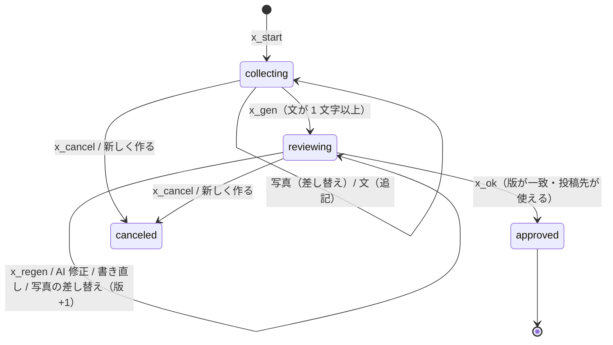
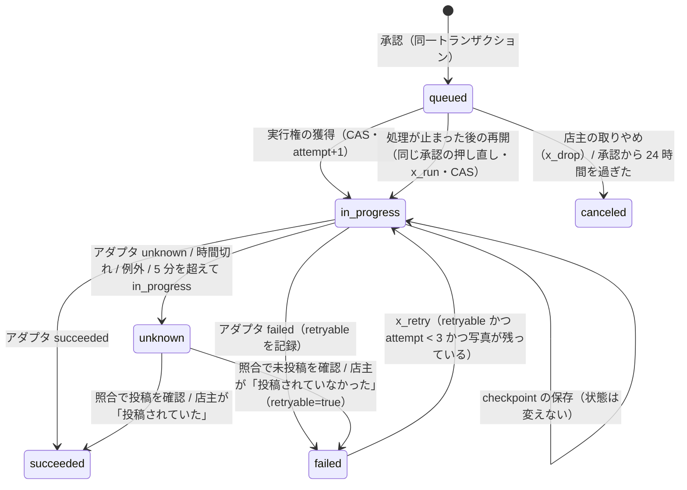

# Technical Design: line-crosspost

## Overview

店主が LINE のトークに写真と伝えたいことを送ると、Instagram 用と Google 用の投稿文を下書きし、店主が確認・修正して投稿先を選び、**最終確認で明示的に承認したときだけ**投稿する。投稿先ごとに状態（成功・失敗・結果不明）を持ち、重複投稿を構造的に防ぐ。

画面はトークの中で完結させる（Flex Message・クイックリプライ・クリップボードのアクション）。比較と理由は `research.md` Decision 1。**これは v1 の仮説で、編集の体験の使いやすさは未検証**（有効化の前に店主で検証する・tasks 8.4）。

### Goals
- IT に不慣れな店主が、普段の LINE の操作（写真を送る・文を送る・ボタンを押す）だけで、投稿先ごとに確認して投稿できる
- 承認した内容と投稿する内容の一致・投稿先ごとの高々 1 回の投稿・結果不明での再投稿の禁止を、DB の条件付き更新で保証する
- 投稿先の API（Instagram・Google）を、共通処理に触れずに後から接続できる
- 既定 OFF。指定した店舗にだけ見せる。OFF のときの挙動は導入前と同じ

### Non-Goals
- Meta の OAuth・トークン・コールバック（別 spec）、Instagram の API 呼び出しの実装（v1 は「準備中」）
- 動画・複数枚・予約投稿・自動投稿
- LIFF の編集画面（将来の拡張・下記）
- 既存の GBP 単体の投稿（`g_post`）・返信の変更

## Boundary Commitments

### This Spec Owns
- 表 `crosspost_drafts`・`crosspost_media`・`crosspost_deliveries` と、その書き込み（line-webhook の SA だけ）
- line-webhook の `src/crosspost/`（会話・生成・発信先の共通処理・Google の発信先アダプタ・写真の取り込み）
- postback の名前空間 `a=x_*`
- 画像メッセージを会話層へ渡す正規化（本機能が有効なときだけ）

### Out of Boundary
- `oauth_tokens`・`gbp_locations`・`gbp_sessions` の書き込み（gbp-post-review-reply）。本機能は読むだけ
- リッチメニューの画像・区画（#354）
- 写真の置き場の Terraform（tasks 6.x の別 PR。本 spec が境界 `MediaStore` を定める）

### Allowed Dependencies
- `@fwlm/db`（新しいアクセサ `crosspost.ts` を足す）・`@fwlm/gemini`・`@fwlm/observability`
- line-webhook の `gbp/client.ts`（Google の発信先アダプタから `publishLocalPost` を呼ぶ）・`gbp/token-store.ts` の `isLinked`・`@fwlm/db` の `getGbpLocation`
- `sharp`（画像の検証・正規化。lockfile に既存の 0.35.5）

### Revalidation Triggers
- Meta のログイン方式が決まったとき（Instagram アダプタの契約・`oauth_provider` の汎用化）
- GBP API の承認後、`localPosts` の写真付き投稿・署名付き URL／プロキシ URL の受理を実測したとき
- 入口のリッチメニューを差し替えるとき（#354）

## Architecture

### Existing Architecture Analysis
- Webhook は `app.ts` が署名検証 → `dispatch.ts` が正規化と重複排除 → `onboarding/conversation.ts` → 店舗特定済みなら `owner/router.ts`。router は GBP へ委譲し、引き受けなければ既存の分岐へ落ちる。
- 処理は Webhook のリクエストの中で同期的に行い、最後に 200 を返す。Cloud Run はリクエストの外で CPU を割り当てない前提なので、**投稿の実行もリクエストの中で終える**（各呼び出しに時間制限）。

### Boundary Map

```mermaid
graph TB
  subgraph line-webhook
    D[webhook/dispatch.ts<br/>image を正規化（有効時のみ）] --> C[onboarding/conversation.ts]
    C --> R[owner/router.ts]
    R -->|x_* postback・作成中の text/image| X[crosspost/flows.ts<br/>会話の状態機械]
    R -->|g_*| G[gbp/flows.ts（既存）]
    X --> GEN[crosspost/prompts.ts<br/>生成と事実の照合]
    X --> IN[crosspost/intake.ts<br/>LINE の写真の取得と正規化]
    X --> PUB[crosspost/publisher.ts<br/>実行権の獲得・結果の分類]
    PUB --> AD{DestinationAdapter}
    AD --> GA[crosspost/adapters/google.ts]
    AD --> IA[crosspost/adapters/instagram.ts<br/>v1 は not_ready]
    GA --> GC[gbp/client.ts publishLocalPost]
    IN --> MS[(MediaStore<br/>非公開の置き場)]
    PUB --> MS
  end
  X --> DB[(crosspost_drafts / media / deliveries)]
  GEN --> GEM[@fwlm/gemini]
```

依存の向き: `flows → (prompts, intake, publisher) → adapters → 既存の gbp/client`。adapters は flows を知らない。`@fwlm/db` のアクセサは domain を知らない。

### Technology Stack
| 層 | 選択 | 理由 |
|---|---|---|
| 会話 | Flex Message・クイックリプライ・postback・clipboard アクション | トークで完結（Decision 1）。clipboard は LINE 14.0.0 以降・1000 字まで |
| 生成 | `@fwlm/gemini`（`gemini-3.1-flash-lite` を既定・`GEMINI_MODEL` で上書き） | GBP の下書きと同じ実行核 |
| 画像 | `sharp` | 復号できることの確認・向きの補正・メタデータの除去・JPEG への再符号化を 1 か所で行う |
| 状態 | PostgreSQL の条件付き更新（CAS） | GBP の実行の排他と同じ規律 |

## File Structure Plan

```
db/migrations/0019_line_crosspost.sql            # 3 表・enum・部分一意索引
ts/packages/db/src/crosspost.ts                  # アクセサ（所有の検証を SQL に含める）
ts/packages/db/test/crosspost.db.test.ts
ts/apps/line-webhook/src/crosspost/
  config.ts        # CROSSPOST_* の読み込み（全部あるか全部無いか）
  domain.ts        # 型・状態・発信先・失敗理由・上限
  postback.ts      # a=x_* の符号化と復号（形式の検証だけ）
  prompts.ts       # 生成・事実の照合・受理条件
  media.ts         # 画像の検証と正規化（sharp）・MediaStore の境界
  intake.ts        # LINE の写真の取得 → 正規化 → 保存
  adapters/types.ts       # DestinationAdapter の契約
  adapters/google.ts      # GBP の localPosts
  adapters/instagram.ts   # v1: not_ready
  publisher.ts     # 承認・実行権の獲得・実行・結果の記録・確認
  messages.ts      # Flex とテキストの組み立て
  flows.ts         # 会話の状態機械（router から呼ばれる）
  logger.ts        # allowlist のロガー
```

変更するファイル: `webhook/dispatch.ts`（image の正規化を有効時だけ）、`owner/router.ts`（委譲点）、`config.ts`・`index.ts`（既定 OFF の配線）、`gbp/client.ts`（`publishLocalPost` を足す。既存の `createLocalPost` は変えない）、`line/client.ts`（Content API の取得を足す）、`db/write-boundary.md`・`db/ERD.md`・`infra/sql/grants.sql`。

## System Flows

### 店主の操作（両方へ投稿する場合）

```
[投稿を作る]（postback a=x_start または「投稿」と送る）
  └ 店舗が複数 → 店舗を選ぶカード（a=x_start&s=<storeId>）
  └ 作成中の下書きがある → [続きから] [新しく作る]
→ 「写真 1 枚と、伝えたいことを送ってください」  QR: [下書きを作る][やめる]
→ 写真を送る → 「写真を受け取りました」         QR: [下書きを作る][やめる]
→ 文を送る（何通でも）→ 「受け取りました」       QR: [下書きを作る][やめる]
→ [下書きを作る]
→ 確認のカルーセル（版 r）
     バブル1 Instagram: 全文・写真の有無・使えるか
        [作り直す][AIに直してもらう][自分で書き直す][文をコピー]
     バブル2 Google: 同上
     バブル3 投稿先: [両方に投稿][Instagramだけ][Googleだけ]（使える組み合わせだけ）
                     使えない理由と準備の導線（[Google と連携する] など）
→ [両方に投稿]（a=x_conf&d&r&t=both）
→ 最終確認: 「この写真を投稿します（横長）」と店主が送った写真のメッセージを引用（quoteToken）
            ＋ 投稿先・各文の冒頭・写真の向き・写り込みの注意  [投稿する][戻る]
→ [投稿する]（a=x_ok&d&r&t=both）   ← 唯一の承認
→ 実行（投稿先ごとに並行・時間制限つき）
→ 結果: Instagram ✓ / Google ？（結果不明: [投稿されていた][投稿されていなかった]）
   ※ 結果を Reply でも Push でも届けられなかったら、次の操作（どの文への返信でも）で
     「お届けできていなかった投稿の結果です」と先に示す。「投稿の状況」と送っても見られる
```

### 下書きの状態機械



- 作成中（`collecting`・`reviewing`）の下書きは **owner あたり高々 1 つ**（部分一意索引）。
- 作成中の下書きは最後の操作から 24 時間で期限切れ。期限切れの行は次の操作で `canceled` にし、写真を消す。
- `approved` の下書きは以後一切変わらない。投稿先ごとの行が状態を持つ。

### 投稿先ごとの状態機械（`crosspost_deliveries.status`）



**不変条件**
1. 外部 API へ投稿を送るのは `in_progress` を獲得したリクエストだけ（`UPDATE ... WHERE status IN ('queued','failed') ... RETURNING`）。
2. `succeeded` から出る遷移は無い。`unknown` から `in_progress` へ直接は行けない（必ず確認を挟む）。`in_progress` から `queued` へ戻る遷移は無い（送ったかもしれないものを「未送信」として再開させない）。
3. 結果の記録は `WHERE status = 'in_progress' AND attempt_count = <獲得した回数>`。遅れて戻った古い試行が新しい試行の結果を上書きしない。

### 承認と実行

```mermaid
sequenceDiagram
  participant O as 店主
  participant W as line-webhook
  participant DB as Cloud SQL
  participant A as Adapter
  O->>W: postback x_ok&d&r&t
  W->>A: availability(store) を投稿先ごとに確認
  W->>DB: BEGIN; UPDATE drafts SET approved WHERE id,owner,status=reviewing,revision=r; INSERT deliveries(本文の写し); COMMIT
  alt 0 行（版の不一致・二重承認）
    W-->>O: 最新の内容で確認し直す案内（何も投稿しない）
  else 承認できた
    par 投稿先ごと
      W->>DB: claim queued→in_progress
      W->>A: publish(snapshot, saveCheckpoint, signal)
      A-->>W: succeeded / failed / unknown
      W->>DB: record (status=in_progress AND attempt=n)
    end
    W-->>O: 結果（20 秒以内に終われば reply、超えたら push）
  end
```

- 結果の通知（詳細は下の「結果の通知」）: 承認から結果までが 20 秒（`replySafeMs`）以内なら Reply、超えたら Reply トークンの期限を見込んで Push。届いたかは `replyChecked`・`pushChecked`（LINE が 2xx を返したか）で判定し、Reply が受け付けられなければ Push も試す。どちらも届かなければ「届けた」と記録せず、次の操作で示す（Req 7.2）。既存の `reply`・`push` は従来どおり非 2xx を例外にせず記録だけを残す（ほかの会話の挙動は変えない）。
- 画像の受け渡し: `webhook/dispatch.ts` は、一括発信が有効なとき（`acceptImages`）だけ、画像の `unsupported` イベントに `image`（`message.id`・`contentProvider`・`imageSet`）を載せる。無効なときは従来どおり内容を持たない。
- AI への修正指示: 指示はその生成の事実の照合の素材に加える（指示に書かれた事実は使ってよい）。素材の文（`material_text`）へは足さない（「もっと短く」などの指示が、ほかの投稿先の生成の素材に混ざらないため）。

二重タップ: 2 本目の `x_ok` は承認の UPDATE が 0 行になる。そのとき下書きが **同じ版で承認済み**なら、新しく承認せず「待ちの投稿先の再開」として扱う（実行権は CAS なので、1 本目が実行中・実行済みの投稿先は送らない）。LINE の再配信は `webhookEventId` の重複排除で処理前に落ちる。

### 承認の後に処理が止まったとき（Req 6.11, 6.12）

| 止まった位置 | 残る状態 | 店主の操作 | 送り直すか |
|---|---|---|---|
| 承認のトランザクションの前 | 確認中（承認されていない） | もう一度「投稿する」 | 通常の承認 |
| 承認の後・実行権の獲得の前 | 待ち（queued） | 同じ「投稿する」の押し直し／「投稿の状況」の [今すぐ投稿する]／[取りやめる] | **送る**（一度も送っていないことが確か） |
| 実行権の獲得の後（外部へ送信中） | 実行中（in_progress）→ 5 分で結果不明 | [投稿されていた]／[投稿されていなかった] → 再試行 | **確認の後だけ** |
| 結果の記録の後・通知の前 | 成功・失敗・結果不明（通知は未） | 次の操作で結果を示す | 送らない |

待ちの再開は店主の操作があるときだけ行う（自動では再開しない）。承認から 24 時間を過ぎた待ちは、店主の知らないうちに古い内容（「本日限定」など）を出さないよう、送らずに取りやめにする。期限は**実行権の獲得（`claimCrosspostDelivery`）の UPDATE の条件にも DB の時計で入れる**ので、取りやめの確認（`reapStale`）と獲得の間に期限を越えても公開しない（第三者レビューの指摘）。

### 結果の通知（Req 7.1, 7.2）

1. 承認から結果までが 20 秒以内なら Reply、超えたら Push（Reply トークンの期限への備え）。Reply が受け付けられなければ Push も試す（`replyChecked`・`pushChecked` は LINE が 2xx を返したかを返す）
2. 届いたら `crosspost_drafts.result_notified_at` に「示した投稿先の行の `finished_at` の最大」を記録する（アプリの時計を使わない）
3. `finished_at` が記録より新しい投稿先を持つ下書き＝届けていない結果。店主の次の操作（一括発信の有効な店主のどの文・開始・状況の確認）で先に示し、届いたら記録する。届けた結果は二度と割り込ませない
4. 下書きの作成中・確認中の文・写真では、まずその入力を下書きへ受け取り、応答の**前に**届けていない結果を添える（最後のメッセージのクイックリプライは下書きの操作のまま・1 回の返信は 5 通まで）。添えた返信が届かなければ記録しない（次の操作に持ち越す）
5. 「投稿の状況」「投稿の結果」は、下書きの作成中・確認中（自分で書き直す途中を含む）でも命令として扱い、下書きを変えない

## Components and Interfaces

### DestinationAdapter（`adapters/types.ts`）

```ts
export type Destination = 'instagram' | 'google';

export type Availability =
  | { kind: 'available' }
  | { kind: 'needs_connection' }   // 未連携（連携の導線を出す）
  | { kind: 'needs_relink' }       // 期限切れ・権限喪失が分かっている
  | { kind: 'not_ready' }          // 本機能側で未接続（API 未承認・アダプタ未実装・投稿先の有効化前）
  | { kind: 'unsupported_content'; reason: ContentIssue }; // 写真が無い・比率が合わない など

export interface PublishInput {
  ownerId: string; storeId: string; deliveryId: string;
  bodyText: string;
  media: { fetchUrl: string; width: number; height: number; byteSize: number } | null;
  checkpoint: string | null;      // 前回の試行で保存した到達点
  signal: AbortSignal;
}

export type PublishOutcome =
  | { kind: 'succeeded'; externalId: string | null; externalUrl: string | null }
  | { kind: 'failed'; reason: FailureReason; retryable: boolean }
  | { kind: 'unknown'; reason: UnknownReason };

export interface DestinationAdapter {
  readonly destination: Destination;
  availability(ctx: { ownerId: string; storeId: string }, content: ContentShape): Promise<Availability>;
  publish(input: PublishInput, saveCheckpoint: (checkpoint: string) => Promise<void>): Promise<PublishOutcome>;
  /** 結果不明の照合。照合の手段を持たない投稿先は undefined（店主による確認に倒す）。 */
  reconcile?(input: ReconcileInput): Promise<ReconcileOutcome>;
}
```

- アダプタは例外を投げない契約。投げても publisher が `unknown`（`adapter_threw`）に畳む。**送信の前か後か分からない失敗は `unknown`**。
- `saveCheckpoint` は DB に書いてから解決する。アダプタは次の外部呼び出しの前に await する。

### Google の発信先アダプタ（`adapters/google.ts`）
- `availability`: GBP の設定が有効・`CROSSPOST_GOOGLE_ENABLED` が真・`tokenStore.isLinked` が真・`gbp_locations.can_operate_local_post` が真。どれかが偽なら順に `not_ready` / `needs_connection` / `unsupported_content`（投稿の権限が無い）。
- 写真の条件: JPEG（または PNG）・短辺 250px 以上・10,240 バイト以上 5MB 以下 [公式: 前提資料 §4.5]。条件外は `unsupported_content`。
- `publish`: `gbpClient.publishLocalPost(db, { ownerId, storeId, summary, photoUrl }, { signal })`。分類:

| 状況 | 分類 | retryable |
|---|---|---|
| 送信前の失敗（未連携・トークン失効・ロケーション未解決・暗号） | failed | 失効は false（再連携）／未連携 false |
| 401・403 | failed（permission_denied） | false |
| 400・404・409・その他の 4xx | failed（rejected） | false |
| 送信後の 429 | **unknown**（rate_limited_after_send） | — |
| 送信前の割り当ての超過・トークンの取得の一時的な失敗（not_sent） | failed（rate_limited / upstream_unavailable） | true（送っていない） |
| 5xx（500・502・503・504 ほか） | **unknown** | — |
| 通信の例外・時間切れ（送信の後か前か分からない） | **unknown** | — |
| 2xx（本文が読めない場合も） | succeeded（`name` を読めれば externalId、`searchUrl` を読めれば externalUrl） | — |

  **作成済みの可能性を否定できない応答は結果不明**にする。5xx は 503 を含めてすべて結果不明（Google が投稿を作った後に 5xx を返さないという一次情報は無い）。送信後の 429 も結果不明にする（割り当ての超過は処理の前に断られるのが通常だが、非冪等な作成で重複が起きないことを GBP API で実測しておらず保証が無い・第三者レビューの指摘）。送信の前に断ったもの（`not_sent`）とは区別し、こちらは送っていないので再送してよい。
- 再連携の導線: 結果の `token_invalid` には GBP の会話の `g_relink`、`not_linked` には `g_connect` のボタンを出す（GBP の連携が有効なときだけ）。
- `reconcile`: v1 は持たない（GBP API が未承認で、`localPosts.list` による照合を実測できない）。店主による確認に倒す。

### Instagram の発信先アダプタ（`adapters/instagram.ts`）
- v1: `availability` は常に `not_ready`、`publish` は呼ばれない（呼ばれたら `failed`・`not_ready`・retryable=false）。
- 接続するときの契約（ログイン方式の決定後に実装・前提資料 §1.1）:
  1. checkpoint が無ければコンテナを作る（`POST /<IG_ID>/media`・`image_url` に `fetchUrl`・`caption`）。**作れたらコンテナ ID を `saveCheckpoint` してから次へ進む**。
  2. コンテナの状態が `FINISHED` になるまで、時間制限の内で確かめる。`ERROR` は failed（retryable=false）、時間切れは unknown。
  3. `POST /<IG_ID>/media_publish`（`creation_id`）。応答を失ったら unknown。
  4. 再試行は checkpoint のコンテナを再利用する（`FINISHED` なら公開だけ、`PUBLISHED` なら succeeded、`EXPIRED` なら新しく作る）。照合（`reconcile`）も同じ状態で判定する。
  - 写真の条件（JPEG・比率・幅・大きさ）はこのアダプタの `availability` に置く。数値は実装の時点で公式文書を再確認して写す（本 spec には数値を書かない）。

### publisher（`publisher.ts`）
- `approve({ownerId, draftId, revision, destinations})`: 投稿先ごとに `availability` を確かめ、1 つでも `available` でなければ承認しない（`stale_destination`）。承認の UPDATE と deliveries の INSERT を 1 トランザクションで行う。
- `runDeliveries(draftId)`: `queued`（と再試行で獲得した行）を投稿先ごとに並行で実行する。各実行は `AbortController` で時間制限（Google 15 秒・Instagram 45 秒）。全体を `Promise.allSettled` で待つ。
- `retry(deliveryId)` / `markObserved(deliveryId, posted)` / `reconcile(deliveryId)`: すべて ownerId を伴う SQL で所有を確かめる。
- 期限切れの `in_progress`（`last_attempt_at` から 5 分）は、状況の表示・再試行・確認の前に `unknown` へ移す。承認から 24 時間を過ぎた `queued` は `canceled` へ移す。
- `cancelQueued(deliveryId)`: 待ちの取りやめ（店主の操作）。
- 写真の削除: 下書きの全投稿先が `succeeded`・`canceled`・再試行できない `failed` になったら、`MediaStore.delete` を試みる（失敗しても置き場の寿命規則が消す）。

### prompts（`prompts.ts`）
- 素材型は `{ storeName, materialText }` だけ。写真・店舗 ID・オーナー ID・住所・電話番号を引数に持たない（`gbp/prompts.ts` と同じ「引数型の狭さ」による保証）。
- 自由記述はデリミタで隔離し、デリミタは不動点まで除去する（`gbp/prompts.ts` と同じ）。
- 1 回の呼び出しで、求められた投稿先（1 つか 2 つ）の文を JSON（`responseMimeType: application/json`）で返させる。
- 出力の検証（`validateOutput`・不合格は `INVALID_OUTPUT` として 1 回だけ作り直す）:
  - 日本語を含む・空でない
  - 受理条件: Instagram 2,200 字以内・ハッシュタグ 5 個以内・`@` を含まない／Google 1,500 字以内・ハッシュタグと電話番号を含まない
  - 生成の目安: Instagram 600 字・Google 400 字以内（クリップボードの 1000 字に収める）。目安を超えたら不合格
  - **事実の照合**: 出力に現れる数字の並び（全角・漢数字の一部を正規化）・URL・メールアドレス・電話番号・宣伝の語（`無料` `割引` `半額` `先着` `限定` `OFF` `%`・`％`）は、素材（＋修正指示）に現れるものに限る
  - Instagram のハッシュタグの語は、素材か店名に現れる語に限る
- **保証の範囲**: 機械的な照合が保証するのは上の数字・URL・メールアドレス・電話番号・宣伝の語・ハッシュタグの語だけである。料理名・食材・産地・人名・受賞歴などの創作は、プロンプトで禁じているが**検知できない**（語彙を網羅する照合は誤検知と保守の負担が大きく、作らない）。事実の保証の最後は店主の確認で、確認のカルーセルと最終確認に「AI が書いた文です。料理名・食材・産地・価格・日付など、伝えていない内容や事実と違うところが無いか、投稿の前に必ず確かめてください」を出し、最終確認には投稿する文の**全文**を示す（Req 3.10, 5.3）
- variation seed は文の形だけを変える候補から選ぶ（CLAUDE.md の AI ガードレール）。

### media / intake（`media.ts`・`intake.ts`）
- `MediaStore`: `put(bytes, contentType) → { key }`／`issueFetchUrl(key, ttlSeconds) → url`／`delete(key)`。v1 の本番の実装（GCS の非公開バケット・寿命 7 日・取得用 URL の方式）は tasks 6.x。テストは in-memory。
- 取得: `GET https://api-data.line.me/v2/bot/message/{id}/content`（時間制限・20MB を超えたら読み止める・`contentProvider.type` が `line` のときだけ）。
- 送った順: Webhook のイベントの `timestamp`（送った時刻・ミリ秒・再配信でも元の時刻を保つ。LINE は「イベントの順序は timestamp で判定する」とする）を `crosspost_media.line_sent_at` に保存し、`attachCrosspostMedia` は**いまの写真より後に送った写真のときだけ差し替える**（下書きの行を FOR UPDATE で固定して比較と差し替えを直列にする）。前に送った写真が処理の遅れで後から届いたら `older`（差し替えず、その旨を伝える）、同じ時刻の別の写真は `ambiguous`、時刻の無い写真は受け取りで断る（どちらも推測で採用せず送り直しを求める・Req 2.5）。まとめて送られた写真は従来どおり `imageSet.index` が 1 のものだけを使う
- quoteToken: 画像メッセージの `quoteToken` を `crosspost_media.line_quote_token` に保存し、最終確認で引用する（research.md Decision 5）。**引用の手掛かりが無い写真（quoteToken が無い）では最終確認も承認もしない**。写真を送り直すよう案内する（送り直した写真には quoteToken が付く）。承認（`x_ok`）の側でも同じ条件を確かめる（古いボタン・偽造された postback で、確かめていない写真を公開しない）。
- 正規化: `Content-Type` とマジックバイトが JPEG／PNG／WebP のいずれか → `sharp` で復号（画素数の上限）→ 向きの補正 → 長辺 1,440px 以内へ縮小（拡大しない）→ sRGB の JPEG（品質 85）。**メタデータは書き出さない**（位置情報を含む EXIF を落とす）。短辺 250px 未満は拒否。
- 保存: 推測できない名前（UUID）。DB には `storage_key`・寸法・バイト数・SHA-256 だけを持つ。
- 写真の差し替えは「新しい行を入れて古い行を消す」を 1 トランザクションで行い、古い実体は後で消す。

### flows（`flows.ts`）
- router から `handlePostback`・`handleText`・`handleImage` を受け、引き受けたら `handled` を返す。
- 引き受ける条件: `x_*` の postback（店主が本機能の有効な店舗を持つとき）／作成中の下書きがあるときの text・image／有効な店舗を持つ店主の「投稿」「投稿する」「投稿を作る」。それ以外は `not_handled`（既存の分岐へ落ちる）。
- テキストの解釈（作成中の下書きの状態ごと）:

| 状態 | 入力モード | テキスト |
|---|---|---|
| collecting | — | 素材へ追記（合計 2,000 字まで。超えたら追記せず伝える） |
| reviewing | none | 反映しない。修正の手段を案内する |
| reviewing | ai_revision(k) | 修正指示として k の文を作り直す |
| reviewing | manual(k) | k の文として採用（受理条件・目安の検証だけ。AI を通さない） |

  `collecting → reviewing` の後に届いた素材の文は追記しない（`status = 'collecting'` を条件にした UPDATE が 0 行）。届いたことと、反映するなら「AI に直してもらう」で伝えるよう返す（黙って捨てない）。

### postback（`postback.ts`）

| data | 意味 |
|---|---|
| `a=x_start[&s=<storeId>]` | 開始（店舗の指定は任意。所有と有効の検証は flows） |
| `a=x_resume` / `a=x_new[&s=<storeId>]` | 作成中を続ける／捨てて新しく作る（店舗の指定が無く複数店舗なら店舗の選択へ） |
| `a=x_gen&d=<draftId>` | 下書きを作る |
| `a=x_regen&d&r&k=<ig\|gg>` | k の文を作り直す |
| `a=x_ai&d&r&k` / `a=x_edit&d&r&k` | AI に直してもらう／自分で書き直す（入力モードへ） |
| `a=x_view&d` | 確認のカードを出し直す |
| `a=x_conf&d&r&t=<ig\|gg\|both>` | 最終確認を出す（投稿しない） |
| `a=x_ok&d&r&t` | **承認して投稿**（唯一の承認） |
| `a=x_cancel&d` | やめる |
| `a=x_status` | 直近の投稿の状況 |
| `a=x_retry&v=<deliveryId>` | 失敗した投稿先の再試行 |
| `a=x_run&v=<deliveryId>` | 待ち（一度も送っていない）の投稿先を今すぐ送る（停止の後の再開） |
| `a=x_drop&v=<deliveryId>` | 待ちの投稿先を取りやめる |
| `a=x_check&v` | 結果不明の照合 |
| `a=x_seen&v&y=<1\|0>` | 店主の確認（投稿されていた／いなかった） |

ID は UUID の形・版は非負整数・k と t は列挙に限る。300 字以内。**所有の検証は flows と SQL の責務**（GBP の postback と同じ分界）。

## Data Models

### Physical Data Model（migration `0019_line_crosspost.sql`）

```sql
CREATE TYPE crosspost_draft_status    AS ENUM ('collecting','reviewing','approved','canceled');
CREATE TYPE crosspost_input_mode      AS ENUM ('none','ai_revision','manual');
CREATE TYPE crosspost_destination     AS ENUM ('instagram','google');
CREATE TYPE crosspost_delivery_status AS ENUM ('queued','in_progress','succeeded','failed','unknown','canceled');

crosspost_drafts(
  id uuid PK, owner_id → owners CASCADE, store_id → stores CASCADE,
  status, input_mode, input_destination crosspost_destination NULL,
  revision int ≥ 0, material_text text ≤ 2000 字,
  instagram_text text NULL ≤ 2200 字, google_text text NULL ≤ 1500 字,
  approved_revision int NULL, approved_at timestamptz NULL,
  result_notified_at timestamptz NULL,   -- 結果を届けた（示した行の finished_at の最大）
  expires_at, purge_after, created_at, updated_at
  CHECK: approved ⇔ approved_at・approved_revision が非 NULL
  CHECK: input_mode = 'none' ⇔ input_destination IS NULL
)
UNIQUE INDEX (owner_id) WHERE status IN ('collecting','reviewing')

crosspost_media(
  id uuid PK, draft_id → crosspost_drafts CASCADE UNIQUE（1 下書き 1 枚）,
  line_message_id text, line_quote_token text NULL（最終確認の引用）, line_sent_at timestamptz（送った時刻・差し替えの順序）,
  storage_key text UNIQUE, content_type 'image/jpeg',
  width int > 0, height int > 0, byte_size int > 0, sha256 char(64), created_at
)

crosspost_deliveries(
  id uuid PK, draft_id → crosspost_drafts CASCADE, destination,
  status, body_text text NOT NULL, with_media bool, media_id → crosspost_media SET NULL,
  attempt_count int 0..10, retryable bool, failure_reason text（列挙の CHECK）,
  unknown_reason text（列挙の CHECK: timeout・network・upstream_5xx・rate_limited_after_send・adapter_threw・stale_in_progress）, checkpoint text, external_id text, external_url text,
  last_attempt_at, finished_at, created_at, updated_at
  UNIQUE (draft_id, destination)
)
```

- **書き込み境界**: 3 表とも TS リアルタイム応答層で、INSERT・UPDATE は **line-webhook の SA だけ**（`infra/sql/grants.sql`）。survey-web・dashboard-api・store-detail には付与しない（客の面・代理店の面から店主の投稿を書けない）。例外は保存期間の削除で、毎時の配信ジョブの SA に `crosspost_drafts`・`crosspost_media` の **DELETE だけ**を与える（`crosspost_deliveries` は CASCADE。参照の動作は表の所有者の権限で行われることを実ロールで確かめた）。削除は `FOR UPDATE` を使わない（UPDATE の権限を要するため）。
- **後方互換・ロールバック**: 追加のみ（既存の表・enum を変えない）。戻すときは 3 表と 4 enum を DROP する（本機能が OFF なら行は無い）。アプリは本機能が OFF のとき 3 表を読まない（migration の適用前にデプロイしても既存の経路は壊れない）。
- **保存期間（Req 8.8）**: 下書き・投稿文は `purge_after` = 作成から 30 日、写真の行は受け取りから 7 日、作成中の下書きは `expires_at`（最後の操作から 24 時間）。**毎時の配信ジョブ（`ts/apps/delivery-job/src/crosspost-retention.ts`）が利用者の操作に依存せず消す**（migration が当たる前の DB では何もしない・失敗しても配信の終了コードを変えない）。line-webhook も開始の操作のついでに同じ削除を呼ぶ（冪等）。写真の実体は置き場の寿命の規則（7 日）が上限を保証し、投稿が終わった下書きの写真は line-webhook がすぐ消す。

## Error Handling

| 事象 | 応答 | 状態 |
|---|---|---|
| 生成の失敗（安全性・API・検証） | 「下書きを作れませんでした」＋[もう一度作る] | 素材と版を保持 |
| 写真の取得・検証の失敗 | 理由（大きすぎる・形式・小さすぎる・取得できない）と送り直しの案内 | ほかの素材を保持 |
| 版の不一致・投稿先が使えなくなった | 「内容が変わりました。最新の内容で確認してください」＋最新のカード | 何も投稿しない |
| 期限切れ | 「時間が経ったため下書きを閉じました」＋[新しく作る] | canceled・写真を削除 |
| 投稿先の失敗 | 平易な理由・再試行（retryable のみ）・再連携 | failed |
| 結果不明 | 「確認できませんでした。自動では投稿し直しません」＋[確認する]／[投稿されていた][投稿されていなかった] | unknown |
| 内部の例外（Reply の前） | 投げる → エラー境界が再試行の案内を 1 回だけ返す（既存） | 変えない |

| 結果を Reply でも Push でも届けられない | 記録しない（`crosspost.notify_failed`） | 結果は DB にあり、次の操作で示す |
| 写真に引用の手掛かりが無い | 最終確認・承認をせず、写真の送り直しを案内する | 何も投稿しない |
| 配信ジョブの保存期間の削除の失敗・migration 未適用 | 未適用なら何もしない。失敗は `delivery-job.crosspost_retention_failed` を記録するだけ | 配信の本処理・終了コードは変えない |
| 承認の後に処理が止まった | 待ちは再開・取りやめを選べる。実行中は 5 分で結果不明 | 上の「承認の後に処理が止まったとき」 |

### Monitoring
- ログは allowlist（`flow`・`destination`・`status`・`failureReason`・`unknownReason`・`attempt`・`durationMs`・`errorKind`）。本文・素材・URL・トークン・LINE ユーザー ID は型として渡せない。
- 結果不明・失敗の件数を数えるログベース指標は、有効化の PR で足す（`check-monitoring-coverage.sh` の規律に従う）。

## Testing Strategy

### Unit
- postback の符号化・復号（列挙外・UUID でない・300 字超・旧形式）
- prompts: 事実の照合（数字・割引語・URL・電話・ハッシュタグ）、受理条件、デリミタの除去、生成器の偽物での再試行
- media: JPEG／PNG の正規化・EXIF（GPS）の除去・向き・縮小・小さすぎる画像・壊れた画像・偽の Content-Type
- google アダプタ: 表の全行（各 HTTP 状態・通信の例外・時間切れ・2xx で本文が読めない）
- publisher: 二重承認・版の不一致・部分成功・時間切れ・遅れて戻った古い試行・期限切れの in_progress・再試行の上限・unknown から直接再試行できないこと
- flows: 状態ごとのテキストの解釈・期限切れ・やめる・写真の差し替え・無効時に何も引き受けないこと

### 障害・同時操作の再現（`test/crosspost/flows.db.test.ts`）
- 両方の投稿先の部分成功（Instagram 失敗・Google 成功／Instagram 成功・Google 通信切断）と、失敗した投稿先だけの再試行
- 通信切断の後に「投稿する」を押し直しても送り直さないこと
- 結果不明の後の確認（投稿されていた／いなかった）と再試行
- 承認の直後の停止（待ちのまま）からの再開・取りやめ・24 時間の期限
- 実行中の停止（実行中のまま）→ 結果不明 → 確認の後だけ途中の到達点で再試行
- 同時操作: 「投稿する」×2、「投稿する」と「やめる」、再試行×2、再開と押し直し、写真の差し替えと承認
- 通知の失敗（Reply 失敗 → Push・両方失敗 → 次の操作で示す）と「投稿の状況」
- 最終確認の写真の引用（差し替えた後は新しい写真を引用する）

### Integration（DB）
- アクセサ: 所有の検証（他のオーナーの下書き・投稿先の行に触れない）・部分一意索引・CAS・CHECK 制約
- 書き込みの権限: line-webhook 以外の SA が 3 表へ書けないこと（配信ジョブは DELETE だけ）。保存期間の削除が、実際の grants.sql の配信ジョブの権限だけで動くこと
- 配信ジョブの保存期間の削除（`ts/apps/delivery-job/test/crosspost-retention.db.test.ts`）

### E2E
- 本機能は既定 OFF なので、既存の E2E が変わらないことを確かめる。有効化の前に、テスト用の店舗で LINE の実機確認（iOS・Android の写真送信・クリップボード・Flex の表示）を行う（tasks 8.x）。

## Security Considerations
- postback の ID は信用しない。すべての SQL に `owner_id` と店舗の所有（`stores.owner_id`）を含める。
- 写真は非公開の置き場。取得用 URL は短い寿命・推測できない値で、投稿の実行中にだけ発行する。
- 店主の写真から EXIF を除去する。生成 AI へ写真を送らない（Decision 2）。
- 本文・写真はログに出さない。外部 API のエラー本文は保持しない（分類の値だけ）。
- 店舗の引継ぎ（`owner-line-unlink`）で `stores.owner_id` が変わった店舗の下書きは、旧オーナーから操作できない（すべての操作で現在の所有を確かめる）。

## 本番有効化の前に確かめる未確認事項

テストは偽の投稿先・偽の LINE で行っており、次は**実 API・実機でしか確かめられない**。モックの成功を確認済みとして扱わない。

| # | 未確認事項 | いまの扱い | 確かめ方・時期 |
|---|---|---|---|
| U1 | Google の**送信後の 429** の後に投稿が作られていないか（作られないなら「再送してよい失敗」へ緩められる） | 結果不明（`rate_limited_after_send`）。店主の確認の後だけ再試行 | GBP API の承認後、テスト店舗で実測する（tasks 8.6）。実測で安全と分かるまで緩めない |
| U2 | Google の 5xx・通信断の後に投稿が作られているか（結果不明の後の照合） | 店主の確認に倒す | `localPosts.list` の実測の後に自動照合を足す（tasks 7.3） |
| U3 | 写真付きのローカル投稿（`media[].sourceUrl`）の受理と、取得用 URL の方式 | 写真付きは「準備中」 | tasks 6.2 |
| U4 | 送信を取り消した写真のメッセージを引用したときの表示 | 引用の手掛かりが無い写真では最終確認を出さない（下）。取り消し後の表示は未確認 | 実機確認（tasks 8.5） |
| U5 | 「文をコピー → 直して送り返す」編集の使いやすさ | v1 の仮説 | 店主 3〜5 人での検証（tasks 8.4） |
| U6 | HEIC など LINE が送る写真の形式（「オリジナル画質」） | JPEG・PNG・WebP 以外は断る | 実機確認（tasks 8.1） |
| U7 | Instagram の API 全般（ログイン方式・権限名・上限・コンテナの状態） | アダプタは「準備中」 | 前提資料 §7.5 の技術検証 |

## Rollout
1. 本 spec・migration・アクセサ・会話・Google アダプタを既定 OFF でマージ（本番の挙動は変わらない）
2. 写真の置き場（GCS・Terraform）を別 PR で用意し、テスト店舗で `CROSSPOST_PILOT_STORE_IDS` を設定（**運営の承認後**）。投稿先が無い状態でも「文をコピーして投稿」で価値の検証ができる
3. GBP API の承認（#146）と実疎通の後、`CROSSPOST_GOOGLE_ENABLED=1`
4. Meta のログイン方式の決定・App Review の後、Instagram アダプタを実装して有効化

## 将来の拡張
- **LIFF の編集画面**: 文の保存だけを LIFF（store-detail）に持たせ、保存で版を進める。承認は LINE の最終確認カードに残す。store-detail の SA に `crosspost_drafts` の文の列だけの UPDATE を付与する。
- 複数枚（カルーセル）: `crosspost_media` の UNIQUE を `(draft_id, position)` へ。Instagram はカルーセルのコンテナ、Google は `media[]`。
