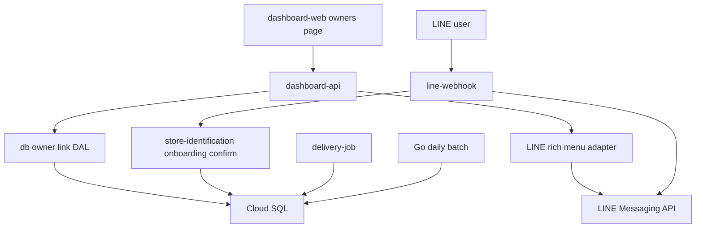
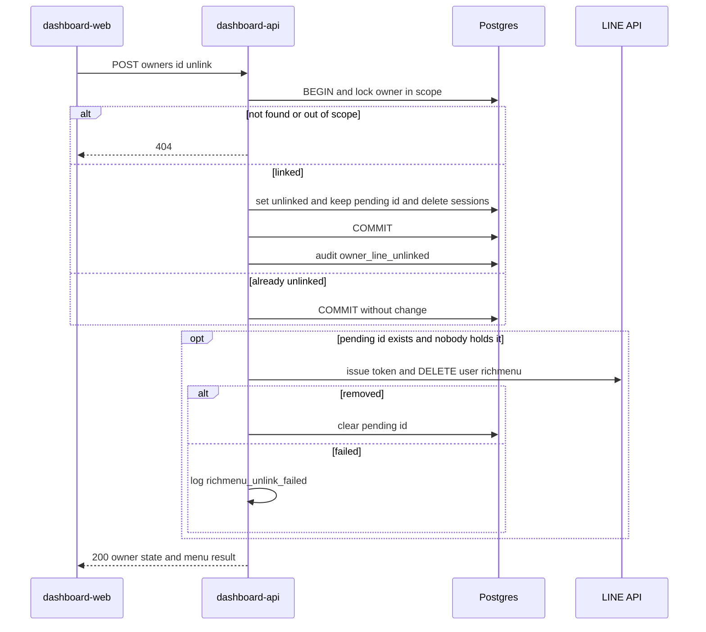
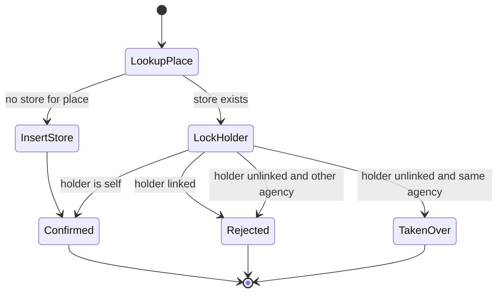
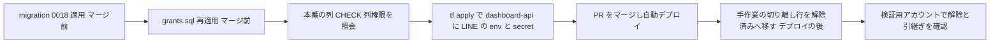

# Design Document: owner-line-unlink

## Overview

**Purpose**: 運営と代理店が、管理ダッシュボードからオーナーと LINE アカウントの紐づけを解除できるようにする。解除した LINE アカウントは招待コードの入力からオンボーディングをやり直せる。解除済みオーナーの店舗と同じ Place を、同じ代理店の招待コードで確定した LINE アカウントは、そのオーナーの全店舗を引き継ぐ。

**Users**: 運営・代理店の利用者は、担当者の交代・誤登録の取り消し・撮り直しのときに、本番 DB を直接書き換えずに紐づけを外す。新しい担当者（または同じ LINE アカウントの持ち主）は、LINE のオンボーディングで自店を確定するだけで店舗と履歴を引き継ぐ。

**Impact**: `owners` に解除の状態を足し、`line_user_id` を nullable にする。dashboard-api に LINE の資格情報とオーナーの解除のルートを足し、line-webhook の確定に引継ぎの分岐を足す。delivery-job は解除済みオーナーの店舗へ配信しない。オーナーの面（line-webhook・survey）からは、列単位の GRANT で解除の列を書けなくする。

### Goals
- 運営・担当代理店が、確認つきの 1 操作でオーナーの紐づけを解除できる（1.1–1.7）
- 解除と同時に完了後メニューの個別リンクを外し、外せなかったときは画面から外し直せる（3.1–3.5）
- 解除した LINE アカウントが、未登録のアカウントと同じ最初の案内から始められる（4.1–4.5）
- 同じ Place の確定で、解除済みオーナーの全店舗と履歴を引き継げる（6.1–6.10）
- オーナー自身が紐づけを外す・配信を止める手段が無いことを、DB の権限と不在検査で保証し続ける（8.1–8.4）

### Non-Goals
- オーナー自身による解除・配信停止（LINE 上・Web 上とも）
- ブロック（unfollow）を契機とした自動解除
- 管理ダッシュボードでの店舗の付け替え操作、解除の取り消し専用の操作
- 解除された LINE アカウントへの通知
- 引き継いだ店舗に付いた GBP の連携の扱い（第2フェーズの有効化の前提条件として別 Issue）
- LINE のトークン発行の実装の共通化（3 つ目の実装になるが、統合は別 Issue）

## Boundary Commitments

### This Spec Owns
- `owners` の連携状態（`line_user_id`・`line_unlinked_at`・`menu_pending_line_user_id`・`taken_over_by_owner_id`）と、その不変条件（CHECK）
- 解除の操作（`POST /owners/:id/unlink`）と、オーナー一覧（`GET /owners`）の連携状態の表示
- 解除時の `onboarding_sessions` の削除と、完了後メニューの個別リンクの解除
- オンボーディングの確定での引継ぎ（`confirmStoreForOnboarding`）
- 解除済みオーナーの店舗を配信の対象から外す述語（delivery-job の 2 クエリ）、GBP の通知・一括張り直しからの除外
- 監査の action 3 値（`owner_line_unlinked`・`owner_stores_taken_over`・`store_taken_over`）
- `owners` の列単位の GRANT と、その検査（`db/test/check_owner_line_privileges.sh`）、不在検査の (B5)

### Out of Boundary
- 店舗の停止・再開（`store-suspension`）。解除・引継ぎは停止状態を読み書きしない
- 日次取得（Go）。`owners` を読まないので変更しない
- 客向けアンケート・QR の発行。`owners` の連携状態を見ないので変更しない
- GBP の連携（`oauth_tokens`・`gbp_locations`・`gbp_sessions`）の引継ぎ時の扱い
- 既存の `StoreIdentificationService.confirmStore`（dashboard-api の店舗登録が使う凍結契約）の振る舞い
- delivery-job・line-webhook の既存の LINE クライアントのトークン発行

### Allowed Dependencies
- dashboard-api → `@fwlm/db`（解除・一覧の DAL）、LINE Messaging API（トークン発行と個別リッチメニューの DELETE だけ）
- line-webhook → `@fwlm/store-identification`（`confirmStoreForOnboarding`）、既存の `LineMessenger`（`unlinkRichMenu` を追加）
- `@fwlm/store-identification` → `@fwlm/db`（店舗の付け替えと施錠の DAL）
- delivery-job → `owners.line_unlinked_at` の読み取りだけ
- **禁止**: line-webhook・survey-web・store-detail から解除の DAL（`unlinkOwnerLine`・`clearOwnerMenuPending`）を import すること。dashboard-api から `confirmStoreForOnboarding` を呼ぶこと

### Revalidation Triggers
- `owners` の列・CHECK・列単位の GRANT の変更（`check_owner_line_privileges.sh` と `grants.sql` の列挙を同時に直す）
- `OwnerRow.line_user_id` の型の変更（旧 LINE ID の全消費箇所に波及する）
- `GET /owners` の応答の形の変更（`agency-dashboard` の店舗登録のオーナー選択が使う）
- `confirmStore` と `confirmStoreForOnboarding` の分担の変更（管理画面の登録が付け替えにならないこと）
- GBP の第2フェーズの有効化（引継ぎ時の GBP の連携の扱いを先に決める）
- dashboard-api の LINE アダプタへ、解除以外の操作を足すこと（Security の前提が崩れる）
- dashboard-api の必須 env の変更（`store-qr-issuance-ui/tasks.md` の env 宣言表を `check-spec-env-names.sh` が照合する）

## Architecture

### Existing Architecture Analysis
- オンボーディングの入口は `findOwnerByLineUserId` → `isStoreIdentified` の 2 段で振り分ける（`line-webhook/src/onboarding/conversation.ts`）。旧 LINE ID でオーナーが引けなくなれば、未登録の経路へ落ちる
- 招待コードの受理で `createOwner` が新しいオーナーを作る。`line_user_id` は UNIQUE なので、旧オーナーが同じ値を持つと失敗する
- store-suspension が「範囲つきの 1 文の更新・範囲外と不存在の同一視・変化したときだけ監査・列単位の GRANT」の型を確立している。本 spec はこれに揃える
- 書込境界は言語単位（`owners`・`onboarding_sessions`・`stores` は TS）。dashboard SA は既にこれらの DML を持つ（`infra/sql/grants.sql:77`）

### Architecture Pattern & Boundary Map



**Architecture Integration**:
- Selected pattern: 既存のレイヤ（app → `@fwlm/*` package → DB）を拡張する。新しいサービス・ジョブは足さない
- Domain/feature boundaries: 解除（dashboard-api）と引継ぎ（line-webhook）は別の書き手が持つ。両者が共有するのは `owners` の状態だけで、解除の列を書くのは dashboard SA だけ、`stores.owner_id` の付け替えを書くのは line-webhook だけである
- Existing patterns preserved: store-suspension のハンドラ・DAL・ダイアログ・列単位 GRANT・不在検査の走査、Issue #228 の「補助的処理は成功も失敗も記録する」、Issue #250 の「監査の失敗は業務を巻き戻さない」
- New components rationale: LINE を同期で呼ぶ主体が dashboard-api に要る（3.1, 3.2）。引継ぎは管理画面の登録と分ける必要がある（Out of scope）
- Steering compliance: GCP 単一帝国・TS 書込の境界を保つ。オーナー向けの Web UI は増やさない

**Dependency direction**: `@fwlm/db` の型 → `@fwlm/db` の DAL → `@fwlm/store-identification` → 各 app のハンドラ・合成ルート → dashboard-web。左から右へだけ import する。

### Technology Stack

| Layer | Choice / Version | Role in Feature | Notes |
|-------|------------------|-----------------|-------|
| Frontend | Next.js（dashboard-web・既存版）＋ `@fwlm/ui` | オーナー一覧の画面と解除のダイアログ | 新しい依存なし |
| Backend | Hono（dashboard-api・既存版） | `POST /owners/:id/unlink`・`GET /owners` の拡張 | 新しい依存なし |
| Backend | Node 24 の `fetch` | LINE のトークン発行と DELETE | `@line/bot-sdk` は足さない（既存 2 アプリと同じ） |
| Data | PostgreSQL 15+（Cloud SQL） | migration 0018（列・CHECK・監査の action） | `infra/sql/grants.sql` の列単位 GRANT |
| Infrastructure | Terraform（run-services） | dashboard-api へ `LINE_CHANNEL_ID` と `line-channel-secret` を配線 | 新しい secret の枠は無い |

## File Structure Plan

### New Files
```
db/migrations/0018_owner_line_unlink.sql          # owners の列・CHECK、ck_audit_logs_action の 28 値での作り直し
db/test/check_owner_line_privileges.sh            # owners の列単位 GRANT を実ロールで検証
ts/packages/db/src/owner-line-link.ts             # 解除・メニュー未解除の消去・引継ぎの DAL
ts/packages/db/test/owner-line-link.db.test.ts    # 上記の実 DB 試験
ts/apps/dashboard-api/src/owner-line-unlink.ts    # POST /owners/:id/unlink のハンドラ
ts/apps/dashboard-api/src/line-richmenu.ts        # LINE アダプタ（トークン発行＋個別リンクの DELETE だけ）
ts/apps/dashboard-api/test/owner-line-unlink.test.ts
ts/apps/dashboard-api/test/owner-line-unlink.db.test.ts
ts/apps/dashboard-api/test/line-richmenu.test.ts
ts/apps/dashboard-web/src/app/owners/page.tsx     # オーナー一覧（連携状態と操作）
ts/apps/dashboard-web/src/app/owners/owner-line-unlink-control.tsx  # 解除・外し直しの操作と確認ダイアログ
ts/apps/dashboard-web/test/owners-page.test.tsx
ts/apps/dashboard-web/test/owner-line-unlink-control.test.tsx
```

### Modified Files
- `ts/packages/db/src/types.ts` — `OwnerRow.line_user_id: string | null`、`line_unlinked_at`・`menu_pending_line_user_id` を追加。`OwnerListItem` に `agencyName`・`lineLink`・`menuUnlinkPending`・`storeNames` を追加
- `ts/packages/db/src/owners.ts` — `OWNER_COLUMNS` に新しい列。`listOwnersByAgency` を `listOwners(db, agencyId | null)` に改め、連携状態・代理店名・店舗名を返す
- `ts/packages/db/src/audit-logs.ts` — `AUDIT_LOG_ACTIONS` に 3 値
- `ts/packages/db/src/index.ts` — `owner-line-link.ts` の公開
- `ts/packages/store-identification/src/store-identification.ts` — `confirmStoreForOnboarding` と `ConfirmForOnboardingOutcome` を追加。`confirmStore` は変えない
- `ts/apps/dashboard-api/src/owners-list.ts` — 運営の代理店未指定を 400 から全件へ。応答に連携状態を足す
- `ts/apps/dashboard-api/src/app.ts` — `POST /owners/:id/unlink` の配線
- `ts/apps/dashboard-api/src/composition.ts` — LINE アダプタと解除のハンドラの合成
- `ts/apps/dashboard-api/src/config.ts` — `LINE_CHANNEL_ID`・`LINE_CHANNEL_SECRET` を必須に
- `ts/apps/dashboard-api/test/app.test.ts`・`app-routes.db.test.ts`・`invite-and-link.db.test.ts`・`store-registration.db.test.ts`・`config.test.ts`（あれば）— 試験の env に LINE の 2 値（ダミー）を足す。LINE アダプタは偽物を注入し、試験から `api.line.me` へ出ない
- `.kiro/specs/store-qr-issuance-ui/tasks.md` — env 宣言表（175 行）に `LINE_CHANNEL_ID`・`LINE_CHANNEL_SECRET` を足す（ローカルの値はダミーでよく、解除のメニュー操作は `menu: 'failed'` として表示される）。足さないと `check-spec-env-names.sh` が赤になる
- `ts/apps/dashboard-web/src/lib/api.ts`・`types.ts` — `listOwners` の拡張と `unlinkOwnerLine`
- `ts/apps/dashboard-web/src/components/top-nav.tsx` — 「オーナー」の項目
- `ts/apps/dashboard-web/src/app/stores/new/page.tsx` — 解除済みのオーナーに「LINE 解除済み」を添える（2.5）
- `ts/apps/line-webhook/src/onboarding/conversation.ts` — `handleConfirm` で `confirmStoreForOnboarding` を使い、引継ぎの監査を残す。`handleFollow` の未登録の経路で個別リンクを外す安全網
- `ts/apps/line-webhook/src/line/client.ts` — `LineMessenger.unlinkRichMenu`
- `ts/apps/line-webhook/src/index.ts` — 確定の配線を `confirmStoreForOnboarding` へ
- `ts/apps/line-webhook/src/gbp/callback.ts` — 解除済み（`line_user_id` が null）のオーナーへ push しない
- `ts/apps/line-webhook/scripts/relink-completed-menu.ts` — `AND line_unlinked_at IS NULL`
- `ts/apps/delivery-job/src/targets.ts` — 2 クエリに `AND o.line_unlinked_at IS NULL`
- `infra/sql/grants.sql` — `owners` の INSERT・UPDATE を line_webhook・survey から列単位へ
- `infra/envs/prod/main.tf` — dashboard-api の `secret_env` に `LINE_CHANNEL_SECRET`、`env` に `LINE_CHANNEL_ID`
- `db/test/check_no_optional_capabilities.sh` — (B5) オーナー・客の面に解除を書く識別子が無いこと
- `scripts/run-db-test-suites.sh` — `check_owner_line_privileges.sh` を RUN 表へ
- `db/test/cross_runtime_integration.sh`（または既存の cross-runtime の TS 試験）— 解除済みオーナーの店舗が「取得される・配信されない」ことの固定
- `db/ERD.md`・`db/write-boundary.md` — 列と書き手（dashboard-api による解除）の追記
- `docs/observability/log-field-canon.md` — 新しい事象 3 つ
- `ts/apps/dashboard-web/e2e/a11y-audit.spec.ts`・`e2e/fixtures/api.ts` — オーナー一覧の面を監査対象へ
- `.kiro/specs/line-onboarding/requirements.md` — Requirement 4.4 の改訂（6.10）
- `.kiro/specs/agency-dashboard/design.md` — `GET /owners` の契約変更の注記
- `docs/testing/e2e.md` — 本番での解除と引継ぎの確認手順（9.1–9.3）

## System Flows

### 解除の操作



- DB の確定（1.1, 1.2, 4.2）と LINE の呼び出し（3.1）は別の段階である。LINE が失敗しても DB は戻さない（3.2）
- 既に解除済みでも、メニュー未解除なら LINE を呼び直す。これが外し直しの操作である（1.5, 3.4）
- 元の ID を別の連携中オーナーが持っている（同じアカウントが再登録済み）なら、LINE を呼ばずに未解除の印を消す。新しいオーナーのメニューを外さないためである

### オンボーディングの確定と引継ぎ



- `LockHolder` は旧オーナーの行を `FOR UPDATE` で施錠し、施錠後に Place の店舗の所有者を読み直す。同時に 2 つのアカウントが確定しても、後着は「所有者が連携中」を読んで `Rejected` になる（6.6）
- `TakenOver` は旧オーナーの全店舗の `owner_id` を新しいオーナーへ書き換え、新しいオーナーを店舗特定済みにする。確定・付け替え・状態遷移は 1 トランザクションである（6.1, 6.3）
- `Rejected` は既存の `place_already_registered` で、案内も既存のまま（6.4, 6.5）

## Requirements Traceability

| Requirement | Summary | Components | Interfaces | Flows |
|-------------|---------|------------|------------|-------|
| 1.1, 1.2 | 運営・担当代理店の解除 | OwnerLineUnlinkHandler, OwnerLineLinkRepo | `POST /owners/:id/unlink`, `unlinkOwnerLine` | 解除の操作 |
| 1.3 | 範囲外・不存在の同一視 | OwnerLineUnlinkHandler, OwnerLineLinkRepo | 404 `not_found` | 解除の操作 |
| 1.4 | 確認ダイアログ | OwnerLineUnlinkControl | — | — |
| 1.5 | 解除済みへの解除は成功 | OwnerLineLinkRepo | `unchanged` | 解除の操作 |
| 1.6 | 店舗・履歴を消さない | OwnerLineLinkRepo, Migration0018 | `owners` だけを更新 | — |
| 1.7 | 失敗時は解除前のまま | OwnerLineLinkRepo, OwnerLineUnlinkControl | 1 トランザクション・500 | — |
| 2.1–2.4 | 連携状態の表示と操作 | OwnersListHandler, OwnersPage, OwnerLineUnlinkControl | `GET /owners` | — |
| 2.5 | 店舗登録のオーナー選択で区別 | StoresNewPage（変更） | `OwnerListItem.lineLink` | — |
| 2.6 | 引継ぎ先の表示 | OwnersRepo, OwnersPage, OnboardingConfirm | `OwnerListItem.takenOverBy`, `taken_over_by_owner_id` | 確定と引継ぎ |
| 3.1 | 解除時にメニューを外す | LineRichMenuAdapter, OwnerLineUnlinkHandler | `unlinkUserRichMenu` | 解除の操作 |
| 3.2 | 外せなかったことを示す | OwnerLineUnlinkHandler, OwnerLineUnlinkControl | `menu: 'failed'` | 解除の操作 |
| 3.3, 3.4 | 外し直し | OwnersPage, OwnerLineUnlinkHandler, OwnerLineLinkRepo | `menuUnlinkPending`, `clearOwnerMenuPending` | 解除の操作 |
| 3.5 | 一括張り直しから除外 | relink-completed-menu（変更） | SQL 述語 | — |
| 4.1 | 最初の案内から再開 | ConversationHandlers（既存）, OwnerLineLinkRepo | `line_user_id` が NULL | — |
| 4.2 | 会話を持ち越さない | OwnerLineLinkRepo | `onboarding_sessions` の削除 | 解除の操作 |
| 4.3 | 詳細画面に出さない | liff-auth（既存・変更なし） | `WHERE line_user_id = $1` | — |
| 4.4 | レポートに出さない | ConversationHandlers（既存・変更なし） | 入口の振り分け | — |
| 4.5 | 解除済みへ送らない | DeliveryTargets, GbpCallback（変更） | SQL 述語, null 判定 | — |
| 5.1 | 取得を続ける | Go daily batch（変更なし） | — | — |
| 5.2–5.4 | 配信も記録もしない | DeliveryTargets | `o.line_unlinked_at IS NULL` | — |
| 5.5 | 停止・アンケート・QR を変えない | OwnerLineLinkRepo | `owners` 以外を更新しない | — |
| 6.1, 6.6 | 同じ代理店で全店舗を引き継ぐ（同時は 1 つ） | OnboardingConfirm, OwnerLineLinkRepo | `confirmStoreForOnboarding` | 確定と引継ぎ |
| 6.2 | 通常の完了と同じ遷移 | ConversationHandlers | `taken_over` を `confirmed` と同じ後処理へ | 確定と引継ぎ |
| 6.3 | 停止・データ・QR を変えない | OwnerLineLinkRepo | `stores.owner_id` だけを更新 | 確定と引継ぎ |
| 6.4, 6.5 | 別の代理店・連携中は拒否 | OnboardingConfirm | `place_already_registered` | 確定と引継ぎ |
| 6.7 | 引継ぎ後の配信 | DeliveryTargets（既存の JOIN） | `stores.owner_id` | — |
| 6.8 | 引継ぎ後の詳細画面 | liff-auth（既存） | `owner_id` で解決 | — |
| 6.9 | 管理画面の店舗一覧 | StoresList（既存） | `JOIN owners` | — |
| 6.10 | line-onboarding 4.4 の改訂 | 文書 | — | — |
| 7.1, 7.3 | 解除の監査 | OwnerLineUnlinkHandler | `owner_line_unlinked` | 解除の操作 |
| 7.2 | 引継ぎの監査 | ConversationHandlers | `owner_stores_taken_over`, `store_taken_over` | 確定と引継ぎ |
| 7.4 | 既存の種別を失わない | Migration0018 | `ck_audit_logs_action` 28 値 | — |
| 8.1, 8.3 | オーナー自身の解除の不在 | GrantsOwnerColumns, AbsenceCheckB5 | 列単位 GRANT, 識別子の走査 | — |
| 8.2 | ブロックで変えない | EventDispatcher（既存・変更なし） | unfollow を無視 | — |
| 8.4 | 変異で検出力を確かめる | OwnerLinePrivilegesCheck, AbsenceCheckB5 | 実施記録 | — |
| 9.1–9.3 | 本番での確認 | ProductionVerification | 手順書 | — |

## Components and Interfaces

| Component | Domain/Layer | Intent | Req Coverage | Key Dependencies | Contracts |
|-----------|--------------|--------|--------------|------------------|-----------|
| Migration0018 | Data | 列・CHECK・監査の action | 1.6, 4.1, 7.4 | — | State |
| GrantsOwnerColumns | Data | オーナーの面から解除の列を剥がす | 8.1, 8.3 | grants.sql (P0) | — |
| OwnerLineLinkRepo | `@fwlm/db` | 解除・未解除の消去・引継ぎの DAL | 1.1–1.3, 1.5–1.7, 3.3, 4.2, 5.5, 6.1, 6.3, 6.6 | Postgres (P0) | Service, State |
| OwnersRepo（変更） | `@fwlm/db` | 連携状態つきのオーナー一覧 | 2.1, 2.5, 2.6 | Postgres (P0) | Service |
| OnboardingConfirm | `@fwlm/store-identification` | 確定か引継ぎかを 1 トランザクションで決める | 6.1–6.6 | OwnerLineLinkRepo (P0) | Service |
| LineRichMenuAdapter | dashboard-api | 個別リンクの解除だけを行う | 3.1, 3.4 | LINE API (P0) | Service |
| OwnerLineUnlinkHandler | dashboard-api | 解除・外し直しの HTTP 境界 | 1.1–1.5, 1.7, 3.1–3.4, 7.1, 7.3 | OwnerLineLinkRepo (P0), LineRichMenuAdapter (P1) | API |
| OwnersListHandler（変更） | dashboard-api | 運営の全件と連携状態 | 2.1 | OwnersRepo (P0) | API |
| OwnersPage・OwnerLineUnlinkControl | dashboard-web | 一覧・確認ダイアログ・結果の表示 | 1.4, 1.7, 2.1–2.4, 2.6, 3.2, 3.3 | dashboard-api (P0) | — |
| ConversationHandlers（変更） | line-webhook | 引継ぎの後処理と監査、follow の安全網 | 3.1, 6.2, 7.2 | OnboardingConfirm (P0), LineMessenger (P1) | — |
| DeliveryTargets（変更） | delivery-job | 解除済みを対象から外す | 4.5, 5.2–5.4 | Postgres (P0) | Batch |
| OwnerLinePrivilegesCheck・AbsenceCheckB5 | 検査 | 不在の機械的な保証 | 8.1, 8.3, 8.4 | grants.sql, 走査面 (P0) | — |

### Data

#### Migration0018

| Field | Detail |
|-------|--------|
| Intent | `owners` の連携状態の列と不変条件、監査の action の追加 |
| Requirements | 1.6, 4.1, 7.4 |

**Responsibilities & Constraints**
- `ALTER TABLE owners ALTER COLUMN line_user_id DROP NOT NULL`（UNIQUE は残す。PostgreSQL の UNIQUE は NULL を重複とみなさない）
- `ADD COLUMN line_unlinked_at timestamptz NULL`、`ADD COLUMN menu_pending_line_user_id text NULL`、`ADD COLUMN taken_over_by_owner_id uuid NULL REFERENCES owners(id) ON DELETE RESTRICT`（既定値なし。既存の全オーナーは連携中から始まる）
- `ADD CONSTRAINT ck_owner_line_link CHECK ((line_unlinked_at IS NULL) = (line_user_id IS NOT NULL))`
- `ADD CONSTRAINT ck_owner_menu_pending CHECK (menu_pending_line_user_id IS NULL OR line_unlinked_at IS NOT NULL)`
- `ADD CONSTRAINT ck_owner_taken_over CHECK (taken_over_by_owner_id IS NULL OR (line_unlinked_at IS NOT NULL AND taken_over_by_owner_id <> id))`
- `ck_audit_logs_action` を `DROP`（`IF EXISTS` を付けない）し、0016 の 25 値に `owner_line_unlinked`・`owner_stores_taken_over`・`store_taken_over` を足した 28 値で作り直す
- 列名は不在検査 (A1) の denylist（`delivery_enabled`・`opted_out` など）と衝突しない
- 旧コードと互換（列の追加・制約の緩和・値集合の拡大だけ）なので、**実装 PR のマージより先に**当てる

##### State Management
- State model:
  - 連携中: `line_user_id IS NOT NULL`・`line_unlinked_at IS NULL`・`menu_pending_line_user_id IS NULL`
  - 解除済み・メニュー未解除: `line_user_id IS NULL`・`line_unlinked_at IS NOT NULL`・`menu_pending_line_user_id IS NOT NULL`
  - 解除済み: `line_user_id IS NULL`・`line_unlinked_at IS NOT NULL`・`menu_pending_line_user_id IS NULL`
- 引継ぎ済み: 解除済みに加えて `taken_over_by_owner_id` が引き継いだオーナーを指す（2.6）。同じオーナーが 2 回引き継がれることは無い（引継ぎ後は店舗を持たない）
- 解除済みから連携中へは戻らない（取り消しは引継ぎで表す）
- Persistence & consistency: 解除の書込は OwnerLineLinkRepo の 1 トランザクションだけ

#### GrantsOwnerColumns（`infra/sql/grants.sql`）
- `REVOKE INSERT, UPDATE ON owners FROM :"line_webhook", :"survey";` を先に行い、次を与え直す
  - `INSERT (id, agency_id, line_user_id, display_name, onboarding_status, created_at, delivery_hour, invite_code_id)`（invite_code_id は #486 の 0017 で足された登録の記録。INSERT だけを与える）
  - `UPDATE (id, agency_id, display_name, onboarding_status, created_at, delivery_hour, taken_over_by_owner_id)`
- line_webhook・survey は `line_user_id` を UPDATE できず、`line_unlinked_at`・`menu_pending_line_user_id` を INSERT も UPDATE もできない。`taken_over_by_owner_id` は引継ぎ（line-webhook）が書くので UPDATE だけを与える。これは配信を止める列ではなく、CHECK により解除済みの行にしか値を持てない。dashboard はテーブル単位の権限のまま
- line-webhook が `owners` に書くのは `createOwner`（INSERT）と `markOwnerStoreIdentified`（`onboarding_status` の UPDATE）だけなので、既存の動作は変わらない
- 引継ぎで line-webhook が書く `stores.owner_id` は、既存の列単位の付与（`grants.sql:91`）に含まれる

### `@fwlm/db`

#### OwnerLineLinkRepo（`owner-line-link.ts`）

| Field | Detail |
|-------|--------|
| Intent | 範囲内のオーナーの解除、メニュー未解除の印の消去、旧オーナーの施錠と店舗の付け替え |
| Requirements | 1.1–1.3, 1.5–1.7, 3.3, 4.2, 5.5, 6.1, 6.3, 6.6 |

**Responsibilities & Constraints**
- 解除は `owners` の 3 列と、`onboarding_sessions` の行（`line_user_id` が元の ID か `owner_id` が当該オーナー）の削除だけを行う。`stores`・集計・監査記録に触れない（1.6, 5.5）
- 範囲の判定と施錠を 1 文で行い、不存在と範囲外を区別しない（1.3）
- 引継ぎの付け替えは `stores.owner_id` だけを書き換える（6.3）

**Contracts**: Service [x] / State [x]

##### Service Interface
```typescript
interface UnlinkOwnerLineInput {
  ownerId: string;
  /** null は運営（全オーナー）。値があればその代理店のオーナーに限る */
  agencyId: string | null;
}

/**
 * menuTarget: これから個別リンクを外すべき LINE ユーザー ID。
 * 未解除の印が無いか、元の ID を別の連携中オーナーが持っている場合は null
 * （後者は同じトランザクションで印を消す）。
 */
type UnlinkOwnerLineOutcome =
  | { kind: 'changed'; ownerId: string; menuTarget: string | null }
  | { kind: 'unchanged'; ownerId: string; menuTarget: string | null }
  | { kind: 'not_found' };

function unlinkOwnerLine(pool: TransactionCapable, input: UnlinkOwnerLineInput): Promise<UnlinkOwnerLineOutcome>;

/** 外せたときに印を消す。印が lineUserId と一致するときだけ消す（並行の解除と取り違えない） */
function clearOwnerMenuPending(db: Queryable, input: { ownerId: string; lineUserId: string }): Promise<void>;

interface PlaceHolder {
  storeId: string;
  ownerId: string;
  agencyId: string;
  unlinked: boolean;
}

/** トランザクション内で、Place の店舗の所有者を施錠して読む（施錠後に読み直す） */
function lockPlaceHolder(tx: Queryable, placeId: string): Promise<PlaceHolder | null>;

/** 旧オーナーの全店舗を新しいオーナーへ移し、旧オーナーの taken_over_by_owner_id を新しいオーナーにして、移した店舗 ID を返す */
function moveAllStores(tx: Queryable, input: { fromOwnerId: string; toOwnerId: string }): Promise<readonly string[]>;
```
- Preconditions: `ownerId` は UUID として妥当（検証は呼び出し側）。`lockPlaceHolder`・`moveAllStores` は呼び出し側が開いたトランザクションの中で使う
- Postconditions: `changed` のとき、オーナーは「解除済み・メニュー未解除」（`menuTarget` が null なら「解除済み」）にあり、元の ID に紐づく会話の行は無い。`unchanged` のとき `owners` は変わらない（`menuTarget` を null にするための印の消去を除く）
- Invariants: `ck_owner_line_link`・`ck_owner_menu_pending` を常に満たす

##### State Management
- Concurrency strategy: 解除は `SELECT … FOR UPDATE` で行ロックを取り、同時の解除は直列化される（後着は `unchanged`）。引継ぎは旧オーナーの行の `FOR UPDATE` で直列化される

#### OwnersRepo（`owners.ts` の変更）
```typescript
type OwnerLineLink = 'linked' | 'unlinked';

interface OwnerListItem {
  id: string;
  displayName: string | null;
  onboardingStatus: OnboardingStatus;
  createdAt: Date;
  agencyId: string;
  agencyName: string;
  lineLink: OwnerLineLink;
  menuUnlinkPending: boolean;
  /** 確定済み店舗の名前（作成順） */
  storeNames: readonly string[];
  /** 店舗を引き継いだオーナー（2.6）。引継ぎが無ければ null */
  takenOverBy: { ownerId: string; displayName: string | null } | null;
}

/** agencyId が null なら全代理店（運営だけが渡す） */
function listOwners(db: Queryable, agencyId: string | null): Promise<OwnerListItem[]>;
```
- 応答に LINE ユーザー ID を含めない（運営・代理店の画面にも出さない）
- `OwnerListItem` は上記に加えて、agency-dashboard Req 8（Issue #486）が足した `inviteCode: { id, code, disabled } | null` を同じ意味のまま持ち続ける。4.4 で `GET /owners` を `listOwners` へ切り替えても #486 の契約を落とさないため。`listOwnersByAgency` は 4.4 まで `listOwners(db, agencyId)` へ委ねて残す

### `@fwlm/store-identification`

#### OnboardingConfirm（`confirmStoreForOnboarding`）

| Field | Detail |
|-------|--------|
| Intent | オンボーディングの確定で、新規作成・自分の重複・引継ぎ・拒否を 1 トランザクションで決める |
| Requirements | 6.1–6.6 |

**Responsibilities & Constraints**
- 新しいオーナーの代理店は `owners.agency_id` から読む（招待コードで決まる）
- 引継ぎは「Place の所有者が解除済み」かつ「代理店が同じ」ときだけ行う
- 既存の `confirmStore` には手を入れない。dashboard-api はこのメソッドを配線しない

**Contracts**: Service [x]

##### Service Interface
```typescript
type ConfirmForOnboardingOutcome =
  | { kind: 'confirmed'; storeId: string }
  | { kind: 'taken_over'; storeId: string; previousOwnerId: string; movedStoreIds: readonly string[] }
  | { kind: 'place_already_registered' };

interface StoreIdentificationService {
  searchCandidates(storeName: string): Promise<SearchOutcome>;
  confirmStore(ownerId: string, candidate: StoreCandidate): Promise<ConfirmOutcome>;
  confirmStoreForOnboarding(ownerId: string, candidate: StoreCandidate): Promise<ConfirmForOnboardingOutcome>;
}
```
- Preconditions: `ownerId` は招待コードの受理で作られたオーナー（連携中）
- Postconditions: `confirmed`・`taken_over` のとき、新しいオーナーは `store_identified`。`taken_over` の `storeId` は確定した Place の店舗
- 手順: BEGIN → `lockPlaceHolder` → 所有者なしなら `createConfirmedStore`（並行の挿入で `ux_stores_place_id` に当たったら ROLLBACK し、最初から 1 回だけやり直す）→ 所有者が自分なら成功 → 解除済みかつ同じ代理店なら `moveAllStores` → `markOwnerStoreIdentified` → COMMIT

### dashboard-api

#### LineRichMenuAdapter（`line-richmenu.ts`）

| Field | Detail |
|-------|--------|
| Intent | LINE ユーザーの個別リッチメニューのリンクを外す。それ以外の LINE の操作を公開しない |
| Requirements | 3.1, 3.4 |

**Dependencies**
- External: `POST https://api.line.me/oauth2/v3/token`（stateless・`client_credentials`）、`DELETE https://api.line.me/v2/bot/user/{userId}/richmenu`（P0）

**Contracts**: Service [x]

##### Service Interface
```typescript
type UnlinkRichMenuResult =
  | { ok: true }
  | { ok: false; errorKind: 'invalid_user_id' | 'token_failed' | 'http_error' | 'network_error'; httpStatus: number | null };

interface LineRichMenuAdapter {
  unlinkUserRichMenu(lineUserId: string): Promise<UnlinkRichMenuResult>;
}

function createLineRichMenuAdapter(deps: {
  channelId: string;
  channelSecret: string;
  fetch: typeof fetch;
  timeoutMs: number;
}): LineRichMenuAdapter;
```
- 2xx と 404 を `ok: true` とする（個別リンクが無いユーザーへの応答が文書化されていないため、外し直しが永久に終わらない事態を避ける）。この仮定は本番の確認（9.2）で GET の 404 とともに実測する
- トークンは呼び出しごとに発行し、キャッシュしない。例外を投げず、結果の型で返す
- LINE ユーザー ID の形（`^U[0-9a-f]{32}$`）に合わない値は、トークンを発行する前に `invalid_user_id` で返す。`encodeURIComponent` は `all`・`..` を通し、`/v2/bot/user/all/richmenu` は既定リッチメニューの解除という別の操作である。解除以外の操作を持たない方針（Security Considerations）をパスの組み立てでも保つ（4.1 のレビューで追加）
- `fetch` は注入する。試験は偽の `fetch`（または合成ルートで偽のアダプタ）を渡し、`api.line.me` へ出ない
- 応答本文・トークン・LINE ユーザー ID を記録しない

#### OwnerLineUnlinkHandler（`owner-line-unlink.ts`）

| Field | Detail |
|-------|--------|
| Intent | 解除と外し直しを 1 つのルートで受け、DB の確定、監査、LINE の解除を順に行う |
| Requirements | 1.1–1.5, 1.7, 3.1–3.4, 7.1, 7.3 |

**Contracts**: API [x]

##### API Contract
| Method | Endpoint | Request | Response | Errors |
|--------|----------|---------|----------|--------|
| POST | /owners/:id/unlink | body なし（範囲は利用者の役割から決める） | `OwnerLineUnlinkResponse` | 401, 403, 404, 500 |

```typescript
type MenuUnlinkResult = 'removed' | 'failed' | 'not_needed';

interface OwnerLineUnlinkResponse {
  owner: { id: string; lineLink: 'unlinked'; menuUnlinkPending: boolean };
  menu: MenuUnlinkResult;
}
```
- 手順: 認証 → UUID の事前ガード（不正形式は 404）→ `resolveAgencyScope` → `unlinkOwnerLine` → `changed` なら `recordAudit(owner_line_unlinked)` → `menuTarget` があれば `unlinkUserRichMenu` → 成功なら `clearOwnerMenuPending` → 応答
- `menu` は `menuTarget` が null なら `not_needed`、LINE が成功し印を消せたら `removed`、それ以外は `failed`（`menuUnlinkPending: true`）
- 事象: 成功は `dashboard-api.richmenu_unlinked`、失敗は `dashboard-api.richmenu_unlink_failed`（項目は `errorKind`・`status` だけ。状態コードは記録の正典の既存の項目名 `status` に載せる。LINE で外せたのに印の消去が DB で失敗したときは errorKind `pending_clear_failed` で記録し、応答は `failed` とする）。Issue #228 に倣い、成功も失敗も記録する
- 監査の失敗は `recordAudit` が警告を残して握る（#250）
- 404 の本文は範囲外と不存在で同一（1.3）

#### OwnersListHandler（`owners-list.ts` の変更）
- 運営が `agencyId` を指定しないとき、400 ではなく全オーナーを返す。代理店の利用者は従来どおり自代理店に束縛され、他の代理店の指定は 403
- 応答の各行に `agencyName`・`lineLink`・`menuUnlinkPending`・`storeNames`・`takenOverBy` を足す

### dashboard-web

#### OwnersPage・OwnerLineUnlinkControl（summary-only）
- `/owners`: オーナー名・担当代理店（運営のみ）・店舗・LINE の連携（「連携中」「解除済み」「解除済み（メニュー未解除）」「解除済み（引継ぎ先: 表示名）」）・操作の列。解除済みのオーナーも一覧に残す（2.3, 2.6）
- 操作は、連携中なら「LINE の連携を解除」、メニュー未解除なら「メニューを外し直す」。解除済みで未解除の印が無ければ操作を出さない（2.2, 2.3, 3.3）
- 解除のダイアログは 1.4 の 3 点（元の LINE に通知が届かず店舗も見られなくなる／店舗と履歴は残る／同じ店舗を LINE で確定し直すと引き継げる）を示し、確定ボタンでだけ送信する。型紙は `stores/store-suspension-control.tsx`
- 結果: `menu: 'failed'` なら「解除しました。LINE のメニューは外せませんでした。『メニューを外し直す』から再試行してください」を示す（3.2）。失敗（4xx・5xx）は成功表示をせず、行の状態を変えない（1.7）。成功後は一覧を取り直し、画面を再読み込みしない（2.4）
- 文言の最終形は `better-writing` の規律と既存の Toast（`app-toaster.tsx`）に揃える

### line-webhook

#### ConversationHandlers（変更）
- `handleConfirm` は `confirmStoreForOnboarding` を呼ぶ。`taken_over` は `confirmed` と同じ後処理（段階を `completed`・`onboarding_completed` の監査・完了の案内・`linkCompletedMenu`）を行い（6.2）、加えて `owner_stores_taken_over`（対象: 旧オーナー）と、移した店舗ごとの `store_taken_over`（対象: 店舗）を `tryAuditLog` で残す（7.2）。主体は新しいオーナー
- `handleFollow` で入口のオーナーが null のとき（未登録・解除済みの元のアカウント）、挨拶の Reply の後に `unlinkRichMenu` を呼ぶ。失敗は `line-webhook.richmenu_unlink_failed` を残して握る（Reply の後なので投げない）。ブロック中で解除が効かなかった元のアカウントに、完了後メニューが残らないようにする安全網である（3.1）
- `LineMessenger.unlinkRichMenu(lineUserId): Promise<void>` を足す（既存の `linkRichMenu` と同じトークン・同じ非 2xx の扱い）。ただし 404 は成功とし、`^U[0-9a-f]{32}$` に合わない ID は通信せずに例外とする（LineRichMenuAdapter と同じ理由。6.1 で追加）。安全網で外せても `menu_pending_line_user_id` は消さない（line-webhook は解除の列を書かない。管理画面の外し直しが 404 を成功として印を消す）

#### GbpCallback・relink-completed-menu（変更）
- `callback.ts`: `owner.line_user_id` が null なら push しない（4.5）
- `relink-completed-menu.ts`: 抽出の SQL に `AND line_unlinked_at IS NULL` を足す（3.5）

### delivery-job

#### DeliveryTargets（変更）
- `queryDeliveryTargets`・`queryOwnersDueWithoutSummary` の WHERE に `AND o.line_unlinked_at IS NULL` を足す。停止の述語（`s.suspended_at IS NULL`）と同じ位置に置く
- 対象の抽出は配信の実行時に行うので、集計の作成後に解除されたオーナーの店舗も外れる（5.4）。抽出から push までの数秒の間の解除は対象外とする
- 引継ぎ後は `stores.owner_id` が新しいオーナーを指すので、既存の JOIN のまま新しい宛先へ届く（6.7）

### 検査

#### OwnerLinePrivilegesCheck（`db/test/check_owner_line_privileges.sh`）
- `check_store_suspension_privileges.sh` と同じ方式（専用のロールを作って `grants.sql` を当て、`has_column_privilege` で問う）
- 検証: dashboard が `line_user_id`・`line_unlinked_at`・`menu_pending_line_user_id` を UPDATE できる／line_webhook・survey が `line_user_id` を UPDATE できず、`line_unlinked_at`・`menu_pending_line_user_id` を INSERT も UPDATE もできず、`taken_over_by_owner_id` を INSERT できない／line_webhook・survey が残りの全列を列挙どおりに INSERT・UPDATE できる（列の足し忘れで赤）／走査した列が 1 以上
- `scripts/run-db-test-suites.sh` の RUN 表に足す

#### AbsenceCheckB5（`check_no_optional_capabilities.sh` に追加）
- オーナー・客の面（B4 と同じ `OWNER_FACING_SCAN_DIRS`）に、解除を書く識別子が無いこと
- パターン: `unlinkOwnerLine|clearOwnerMenuPending|line_unlinked_at[[:space:]]*=([^=]|$)|menu_pending_line_user_id[[:space:]]*=([^=]|$)|line_user_id[[:space:]]*=[[:space:]]*null`（大小を区別しない）。line-webhook の `unlinkRichMenu` には当たらない
- 走査ファイル数 0 を赤にする既存の規律を流用する

## Data Models

### Domain Model
- 集約: オーナー（連携状態を持つ）。店舗はオーナーに属し、引継ぎで所属するオーナーだけが変わる
- ドメインイベント（監査記録）: `owner_line_unlinked`（主体: 運営・代理店／対象: オーナー）、`owner_stores_taken_over`（主体: 新しいオーナー／対象: 旧オーナー）、`store_taken_over`（主体: 新しいオーナー／対象: 店舗）
- 不変条件: 連携中のオーナーは LINE ユーザー ID を 1 つ持ち、同じ ID を持つ連携中のオーナーは 1 人だけ。解除済みのオーナーは ID を持たない。引継ぎは同じ代理店の中でだけ起こる

### Logical Data Model
- `owners`: 上記 3 列（Migration0018）。`stores.owner_id`・`audit_logs`・`gbp_sessions.owner_id` の参照先として行は残り続ける
- `onboarding_sessions`: 解除時に元の ID の行を削除する（PK = `line_user_id`）
- `summary_deliveries.line_user_id`: 送信時の宛先の記録として変えない

### Data Contracts & Integration
- `GET /owners` の応答は、店舗登録の画面（`agency-dashboard`）と本 spec の画面の両方が使う。追加のフィールドだけなので、既存の読み手は影響を受けない
- LINE ユーザー ID は dashboard-api の応答・ログ・監査記録のいずれにも出さない

## Error Handling

### Error Strategy
- DB の確定は 1 トランザクションで、失敗すれば解除前のまま 500（1.7）
- LINE の失敗は DB を巻き戻さず、`menu: 'failed'` と未解除の印で表す（3.2）
- 監査の失敗は警告を残して握る（#250）

### Error Categories and Responses
- 401: 未認証。403: 未登録・無効化の利用者、代理店の所属が欠けた利用者。404: 不正な UUID・不存在・範囲外（同一の本文）
- 500: DB の失敗。LINE の失敗は 200 の `menu: 'failed'`
- line-webhook の確定: 引継ぎの拒否は既存の `place_already_registered` の案内。トランザクションの失敗は既存のエラー境界（汎用の再試行案内）

### Monitoring
- `docs/observability/log-field-canon.md` に `dashboard-api.richmenu_unlinked`・`dashboard-api.richmenu_unlink_failed`・`line-webhook.richmenu_unlink_failed` を登録する（`check-log-field-canon.sh`）
- アラートは足さない。メニュー未解除はオーナー一覧の印で運営が気づける

## Testing Strategy

### Unit Tests
- OwnerLineUnlinkHandler: 運営・代理店の範囲、範囲外と不存在の同一 404、不正 UUID の 404、`changed` だけの監査、`menu` の 3 値（LINE の成功・失敗・不要）、監査の失敗でも 200
- LineRichMenuAdapter: 2xx・404 を成功、その他の状態とトークン発行の失敗とネットワーク例外を `ok: false` へ写すこと、記録に ID と本文が載らないこと
- ConversationHandlers: `taken_over` で `confirmed` と同じ後処理と 3 種の監査が出ること、未登録の follow で挨拶の後に `unlinkRichMenu` を呼び、その失敗が Reply を壊さないこと
- OwnerLineUnlinkControl: 確認ダイアログの 3 点、キャンセルで送らないこと、`menu: 'failed'` の文言、失敗で行の状態が変わらないこと

### Integration Tests（実 DB）
- OwnerLineLinkRepo: 解除で 3 列と会話の行が変わり、店舗・集計・停止状態が変わらないこと。解除済みへの解除が `unchanged`。元の ID を連携中の別オーナーが持つとき `menuTarget` が null で印が消えること。CHECK が不正な組み合わせを拒むこと
- 同じ LINE アカウントでの解除 → 招待コード → 同じ Place の確定で、旧オーナーの全店舗（確定済み・未確定・停止中を含む）が移り、QR（店舗 ID）と日次データが残り、旧オーナーの `taken_over_by_owner_id` が新しいオーナーを指すこと
- 引継ぎの拒否: 別の代理店・連携中の所有者。同時の 2 確定で片方だけが `taken_over` になること（2 つの接続で並行に実行する）
- dashboard-api の店舗登録（`confirmStore`）が、解除済みオーナーの Place に対して `place_already_registered` のままであること（Out of scope の固定）
- delivery-job: 解除済みオーナーの店舗が `queryDeliveryTargets`・`queryOwnersDueWithoutSummary` のどちらにも出ず、`summary_deliveries` に行が増えないこと
- `listOwners`: 運営の全件・代理店の範囲・連携状態・店舗名

### Cross-Runtime Contract
- 解除済みオーナーの店舗について、Go の日次取得が日次サマリーを作り（5.1）、TS の配信がそれを送らない（5.2）ことを、固定日 2026-07-12 の行で確かめる（memory `cross-runtime-fixed-date-seed`）

### E2E / UI
- dashboard-surfaces: `/owners` で解除 → 行が「解除済み」になる、メニューの失敗のスタブで外し直しの操作が出る
- a11y-audit: `/owners` と解除のダイアログを監査の面へ足す（ダイアログは同一 URL の後続状態なので明示的に開いてから監査する）

### Guards
- `check_owner_line_privileges.sh`・(B5)・`check-log-field-canon.sh`・`check-secret-declaration-coverage.sh`（dashboard-api の消費側の配線）
- 8.4 の変異: `grants.sql` で line_webhook に `line_user_id` の UPDATE を戻す → 権限の検査が赤。line-webhook の `src` に `unlinkOwnerLine` の import を足す → (B5) が赤。赤を実測してから戻し、PR に記録する

## Security Considerations
- **LINE の資格情報の配布**: dashboard-api が `line-channel-secret` を読めるようになる。この secret でトークンを発行すると、公式アカウントとして push を含む全操作ができ、Webhook の署名も偽造できる。緩和策は 3 つ。(1) dashboard-api の LINE アダプタは個別リンクの解除だけを公開し、push の経路をコードに持たない。(2) dashboard SA は既に `owners`・`stores` の DML を持ち、DB を直接書き換える力は Webhook の偽造で得られる力より大きい。(3) Revalidation Trigger として、アダプタへの操作の追加を設計の見直し対象にする
- **権限の二重化**: アプリの RBAC（範囲つきの 1 文）と、DB の列単位 GRANT（オーナーの面から解除の列を剥がす）の両方でオーナー自身の解除を防ぐ
- **個人に紐づく識別子の保持**: 元の LINE ユーザー ID は、メニューを外し終えるまでの間だけ `menu_pending_line_user_id` に残し、外せたら消す。応答・ログ・監査には出さない
- **引継ぎの濫用**: 引継ぎに必要なのは、同じ代理店の有効な招待コードと、解除済みオーナーの店舗の Place の確定である。解除は運営・担当代理店の操作でしか起きないので、連携中のオーナーの店舗は奪えない。**残るリスク**: 招待コードは `disabled_at` でしか失効しない多用途のコードなので、解除から正規の担当者が確定するまでの間に、同じコードを知る別の LINE アカウントが店舗を引き継げる。得られるのは Places の公開データと匿名集計、日次の通知だけで、客の個人情報は含まない。**検知と復旧**: オーナー一覧が解除済みオーナーの引継ぎ先を表示し（2.6）、監査記録が主体を残す（7.2）。意図しない引継ぎは、引き継いだオーナーを再び解除し、正規の担当者が同じ Place を確定し直せば戻せる。期限による制限は設けない（2026-10-24 の決定）
- CSRF・CORS は既存の dashboard-api（Bearer の ID トークン・POST 許可済み）のまま

## Migration Strategy



- Step A は旧コードと互換なので、実装 PR のマージより先に当てる（マージが自動デプロイを起動するため）。番号 0018 は提出直前に open PR と照合する
- **Step E のデプロイを確かめた後に、2026-10-24 の手作業の切り離しを正規の状態へ移す（一回限り）。** 旧コードのうちに移すと、旧 delivery-job は解除済みを対象から外す述語を持たないので、配信時刻のたびにその店舗の配信の予約が `summary_deliveries.line_user_id` の NOT NULL で失敗する（手順書の作成で発見・2026-10-29）。移す前の `detached-` の行は CHECK の上では連携中として有効なので、A〜E の間に残しておいてよい。本番の `owners` に `line_user_id LIKE 'detached-%'` の行が残っていれば、それは CHECK の上では「連携中」で、店舗を引き継げず、配信ジョブが存在しない宛先へ push を試み続ける。照会で件数と対象を確かめてから、`line_user_id = NULL`・`line_unlinked_at = 当日の時刻`・`menu_pending_line_user_id = NULL`（メニューは手作業で外し済み）へ更新し、更新件数を DO ブロックで照会の件数と突き合わせる。退避は 2026-10-24 の手順と同じく `row_to_json` で手元へ取る。0 件ならこの手順は何もしない（撮影後に手で戻した場合）。手順は `docs/testing/e2e.md` に載せ、実施の記録を Issue #487 に残す
- Step B は付与者が一致しないと REVOKE が警告だけで空振りする（store-suspension の教訓）。Step C で、line_webhook・survey が `line_user_id` を UPDATE できないことを `has_column_privilege` で確かめるまで Step E へ進まない
- Step D は**イメージより先**に入れる。新しい dashboard-api は `LINE_CHANNEL_ID`・`LINE_CHANNEL_SECRET` が無いと起動時に落ちる（memory `deploy-pipeline-coverage-guards`）。旧イメージは未知の env を無視する
- Step F（9.1–9.3）: 検証用テナント（memory `prod-e2e-leaves-permanent-tenant`）の運営自身のアカウントを解除し、最初の案内と `GET /v2/bot/user/{userId}/richmenu` の 404 を確かめる。続けて同じ Place を確定し直し、店舗詳細画面に店舗が出ることを確かめる。結果を `docs/testing/e2e.md` の手順に沿って Issue #487 に記録する
- ロールバック: アプリを前のリビジョンへ戻すと、旧コードは `line_user_id` が NULL のオーナーを引けないだけで動き続ける。ただし旧 delivery-job は解除済みの述語を持たないので、NULL を宛先に push を試みて失敗を記録する。ロールバック中は解除の操作を控える
